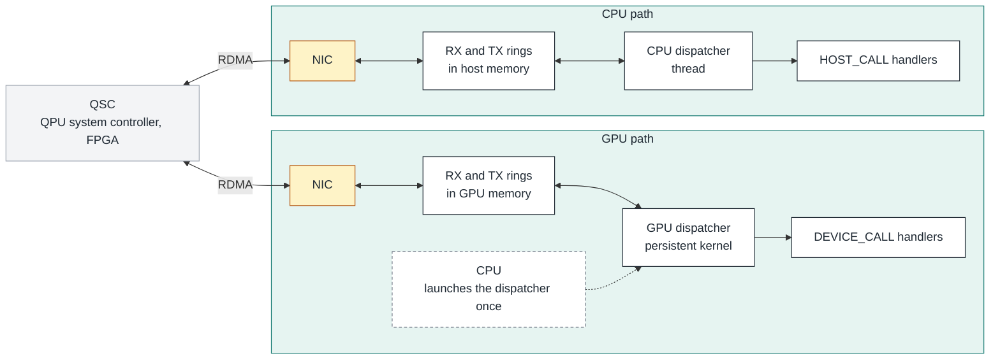
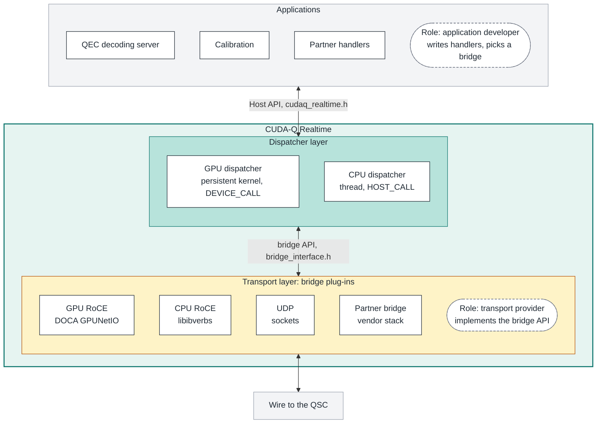
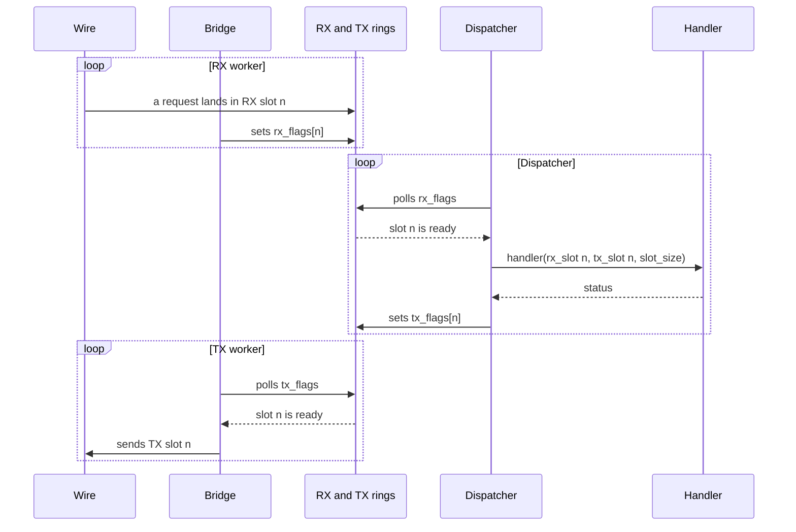
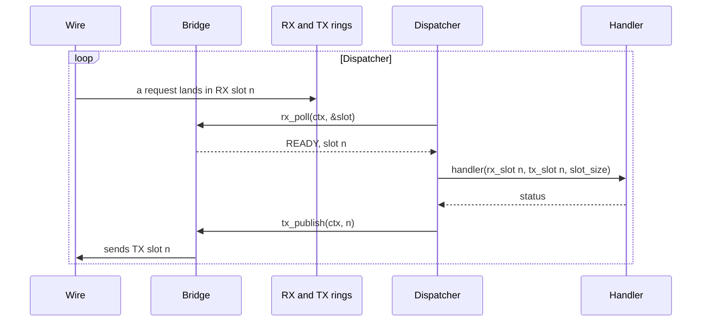

# CUDA-Q Realtime Architecture

CUDA-Q Realtime is a transport-agnostic RPC system over RDMA between a quantum
processor's system controller (the `QSC`, typically an FPGA) and a host. The
`QSC` sends a request, a handler on the host's CPU or GPU runs it within
microseconds, and the response goes back the same way.

## Vocabulary

| Term | Meaning | In the code |
|------|---------|-------------|
| Data path | Where a request lands and which processor dispatches it: the CPU path or the GPU path | `CUDAQ_DISPATCH_PATH_HOST`, `CUDAQ_DISPATCH_PATH_DEVICE` |
| Dispatcher | The loop that reads a request, finds its handler, runs it and writes the response. A CPU dispatcher is a thread, a GPU dispatcher a persistent kernel | `cudaq_dispatcher_t` |
| Handler | The function that serves one RPC, registered in the function table under the hash of its name | `cudaq_function_entry_t` |
| Dispatch mode | How the dispatcher calls a handler | `CUDAQ_DISPATCH_DEVICE_CALL`, `CUDAQ_DISPATCH_HOST_CALL`, `CUDAQ_DISPATCH_GRAPH_LAUNCH` |
| Bridge | A plug-in library that implements the bridge API | `cudaq_realtime_bridge_interface_t` |
| Transport provider | The networking stack under a bridge: DOCA `GPUNetIO`, `libibverbs`, sockets, or a partner's stack | |
| Rings | The RX and TX slot arrays requests and responses live in | `cudaq_ringbuffer_t` |
| Three-worker model | An RX worker, the dispatcher and a TX worker loop independently and share only the rings | `CUDAQ_KERNEL_REGULAR` |
| Unified worker | The dispatcher is the only loop and drives the transport through the bridge's data plane | `CUDAQ_KERNEL_UNIFIED` |
| Data plane | The `rx_poll` and `tx_publish` hooks a bridge hands the unified worker | `cudaq_cpu_dataplane_t`, `cudaq_gpu_dataplane_t` |

The three-worker model is what older pages call the "3-kernel architecture".
It works the same way with CPU threads, hence the name used here.

## RPC over RDMA

The `QSC` and the host each own a set of rings. At connect time the `QSC`
learns where the host's RX ring is (base address, slot stride, remote key), so
it can write a request straight into any slot. No socket and no CPU copy sit
on the data path: the NIC writes into ring memory and the dispatcher reads it
there.

## Two data paths

Requests take one of two paths, chosen by where the rings live:

- **GPU path**: the NIC writes into rings in GPU memory, and a persistent
dispatcher kernel runs `DEVICE_CALL` handlers on the GPU. The CPU launches
that kernel once and stays off the data path. Served by the GPU RoCE bridge.
- **CPU path**: the NIC writes into rings in host memory, and a dispatcher
thread runs `HOST_CALL` handlers on the CPU. Served by the CPU RoCE and `UDP`
bridges.

The two paths do not talk to each other. A GPU dispatcher and a CPU dispatcher
can share one ring set (`shared_ring_mode`), each serving the function IDs in
its own table, but neither hands a request to the other.

### From the CPU path to the GPU

A request that reaches the CPU can still use the GPU: its `HOST_CALL` handler
can copy the data to GPU memory and launch a kernel, or hand the request to a
kernel that is already running, which may do its own dispatch.

## Two layers, two roles

Realtime has two layers: the **dispatcher**, which runs handlers, and the
**transport**, which moves bytes. The bridge API between them makes realtime
transport-agnostic: every transport is a plug-in behind the same API, and any
application on top works with any of them.

The two APIs give two roles:

- **Transport provider: bring your own transport.** Implement the bridge API in
[`bridge_interface.h`](../include/cudaq/realtime/daemon/bridge/bridge_interface.h)
and ship it as a plug-in library. The bridge API provides the
transport agnostic layer to applications. Existing applications, such as the CUDA-Q
QEC decoding server, then run over it unchanged. See
[the network interface page](cudaq_realtime_network_interface.md) for the
walkthrough.
- **Application developer: bring your own handlers.** Program against the
Host API in
[`cudaq_realtime.h`](../include/cudaq/realtime/daemon/dispatcher/cudaq_realtime.h):
register a function table of handlers and run a dispatcher. Choosing the
bridge library and wiring it to the dispatcher is the application's job.

### RPC protocol and handler convention

In addition to the bridge and host APIs, CUDA-Q Realtime defines two
additional contracts:

- an RPC protocol
- a handler calling convention

All four contracts are summarized in the table below.

| Contract | Between | Defined in | Read more |
|----------|---------|------------|-----------|
| Host API | application and dispatcher | [`cudaq_realtime.h`](../include/cudaq/realtime/daemon/dispatcher/cudaq_realtime.h) | [Host API](cudaq_realtime_host_api.md) |
| Bridge API | dispatcher and transport | [`bridge_interface.h`](../include/cudaq/realtime/daemon/bridge/bridge_interface.h) | [Network interface](cudaq_realtime_network_interface.md#extending-cuda-q-realtime-with-a-custom-networking-interface) |
| RPC protocol | `QSC` and handler, through the ring slots | [`dispatch_kernel_launch.h`](../include/cudaq/realtime/daemon/dispatcher/dispatch_kernel_launch.h) | [Message protocol](cudaq_realtime_message_protocol.md) |
| Handler calling convention | dispatcher and handler | `DeviceRPCFunction` in [`dispatch_kernel_launch.h`](../include/cudaq/realtime/daemon/dispatcher/dispatch_kernel_launch.h), `cudaq_host_rpc_fn_t` in [`cudaq_realtime.h`](../include/cudaq/realtime/daemon/dispatcher/cudaq_realtime.h) | [Calling convention](cudaq_realtime_host_api.md#handler-calling-convention), [host handlers](cudaq_realtime_host_api.md#host-dispatch-path-host_call), [device code](device_code_contract.md) |

## Three workers or one

Historically, the dispatcher met the bridge only through the rings. Three
independent loops spin, the bridge's RX worker, the dispatcher and the bridge's
TX worker, and pass each request on through flags in shared memory. Those
hand-offs between loops have proven to cost more latency than the unified
worker, where the dispatcher is the only loop and calls into the transport
itself. The three-worker model is still supported, but for lower latency,
applications are encouraged to switch to the unified worker
(`CUDAQ_KERNEL_UNIFIED` in the dispatcher configuration).

What the bridge has to provide differs between the two:

- **Three-worker model:** the rings, and the RX and TX worker loops that fill
  and drain them and set their flags.
- **Unified worker:** the rings, and the `rx_poll` and `tx_publish` callbacks
  the dispatcher calls in place of those loops.

### Three-worker model

None of the three loops calls another. Each tells the next that a slot is
ready by setting a per-slot flag in shared memory. The three loops run at the
same time. The diagram follows one request through each in turn. Compare it
with the unified worker below, where one loop does all three with calls
instead of flags.

The rings and their flags are the whole contract: the bridge hands them over
with `get_ring_buffer` and the dispatcher polls them. Every request costs two
flag hand-offs between loops.

### Unified worker

The faster alternative runs one loop instead of three. The bridge also hands
the dispatcher two hooks into its transport, and the dispatcher calls them
itself: `rx_poll` claims the next ready request, `tx_publish` puts a response
on the wire.

It is almost the same API as the three-worker model: the same rings, the same
function table, the same handlers. What it adds is two hooks, which replace the
flag traffic between loops:

| | Three-worker model | Unified worker |
|--|--------------------|----------------|
| Loops | three: RX worker, dispatcher, TX worker | one: the dispatcher |
| Hand-off between them | per-slot flags in shared memory | function calls |
| What the bridge provides | the rings (`get_ring_buffer`) and its RX and TX worker loops (started by `cudaq_bridge_launch`) | the rings and the `rx_poll` / `tx_publish` callbacks: `get_cpu_dataplane` on the CPU path, `get_gpu_dataplane` on the GPU path |
| Dispatcher configuration | `CUDAQ_KERNEL_REGULAR` | `CUDAQ_KERNEL_UNIFIED` |

On the CPU path the hooks are plain function pointers in
`cudaq_cpu_dataplane_t`, next to the rings. On the GPU path they are device
functions (`cudaq_dev_enter_kernel`, `cudaq_dev_rx_poll`,
`cudaq_dev_tx_publish`) that the bridge ships as relocatable device code. The
dispatcher links them with its kernel and the application's handlers at run
time, when the application first looks up a handler.

The application does not wire the two models differently.
`cudaq_dispatcher_set_bridge` reads the configured `kernel_type` and asks the
bridge for the matching rings or hooks. It fails if the bridge was started for
the other model. All three in-tree bridges serve both:

| Bridge | Data path | Three-worker model | Unified worker |
|--------|-----------|--------------------|----------------|
| GPU RoCE | GPU | yes | GPU data plane |
| CPU RoCE | CPU | yes | CPU data plane |
| `UDP` | CPU | yes | CPU data plane |

### When to use which

**Unified worker** (`CUDAQ_KERNEL_UNIFIED`):

- The default. Applications are encouraged to use it in most cases.
- Lowest latency: one loop, with calls instead of flag hand-offs.
- Served by every in-tree bridge, on both data paths.

**Three-worker model** (`CUDAQ_KERNEL_REGULAR`):

- May still be needed for GPU dispatch with a dispatcher that relaunches
  itself. Its dispatch kernel can end its run with a CUDA graph tail launch of
  itself, which lets it fire any number of follow-up graphs. Meanwhile the RX
  and TX workers keep running and requests wait in the rings.
- The unified kernel sets up its transport once, through
  `cudaq_dev_enter_kernel`, when it starts. So each relaunch would repeat that
  setup and pause the transport. Until it is clear whether a unified kernel
  can relaunch itself efficiently, the three-worker model stays.
