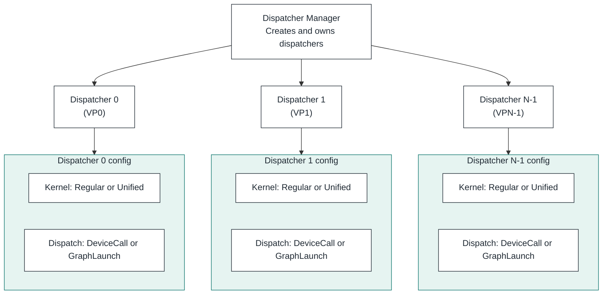

# CUDA-Q Realtime Host API

This document explains the C host API for realtime dispatch, the RPC wire
protocol, and complete wiring examples. It is written for external partners
integrating CUDA-QX decoders with their own transport mechanisms. The API and
protocol are **transport-agnostic** and support multiple data transport options,
including the NVIDIA GpuRoceTransceiver (RDMA via ConnectX NIC's, from the
Holoscan Sensor Bridge project), `libibverbs`, and proprietary transport layers.
Handlers can execute on GPU (via CUDA kernels) or CPU (via host threads).

## Host API Overview

Header: `realtime/include/cudaq/realtime/daemon/dispatcher/cudaq_realtime.h`

## Manager and Dispatcher Topology

The manager is a lightweight owner for one or more dispatchers. Each dispatcher
is configured independently (e.g., `vp_id`, `kernel_type`, `dispatch_mode`) and
can target different workloads.



## Wiring bridge and dispatcher

Wiring a dispatcher to a bridge takes the same few calls for every transport,
data path and worker model:

```c
cudaq_bridge_create_from_library(&bridge, "libcudaq-realtime-bridge-udp.so",
                                 argc, argv);           // load the plug-in
cudaq_dispatch_manager_create(&manager);
cudaq_dispatcher_create(manager, &config, &dispatcher); // path, mode, model
cudaq_dispatcher_set_bridge(dispatcher, bridge);        // rings or data plane
cudaq_dispatcher_set_function_table(dispatcher, &table);
cudaq_dispatcher_set_control(dispatcher, &shutdown_flag, &stats);
cudaq_dispatcher_start(dispatcher);
cudaq_bridge_connect(bridge);
cudaq_bridge_launch(bridge);
// ... serve requests ...
cudaq_dispatcher_stop(dispatcher);                      // raises its own shutdown flag
cudaq_dispatcher_destroy(dispatcher);
cudaq_dispatch_manager_destroy(manager);
cudaq_bridge_disconnect(bridge);
cudaq_bridge_destroy(bridge);
```

Example:

- [`cudaq_realtime_test_server.cpp`](../unittests/test_server/cudaq_realtime_test_server.cpp):
one server for any bridge library, either data path and either worker model,
with each wiring step numbered.

The full API can be found in
[`cudaq_realtime.h`](../include/cudaq/realtime/daemon/dispatcher/cudaq_realtime.h).

## Device Handler and Function ID

A `CUDAQ_DISPATCH_DEVICE_CALL` handler runs on every thread of the dispatch
block: both the ring (3-kernel) and the unified kernel call it on each thread
of their block with identical arguments, between two `__syncthreads()`, and
only the first thread's return value is recorded.  A handler that does not
partition its work should do it on one thread and return early on the others;
barriers inside a handler must be reached by every thread, and there is no
grid-wide sync (not a cooperative launch).  The full contract is in the
`DeviceRPCFunction` doc comment in `dispatch_kernel_launch.h`.

Adapted from `test_realtime_decoding.cu` (the actual test uses a library helper,
`setup_mock_decode_function_table`, that performs equivalent setup via
`cudaMemcpy`):

```cpp
// The dispatcher uses function_id to find the handler
constexpr std::uint32_t MOCK_DECODE_FUNCTION_ID =
    cudaq::realtime::fnv1a_hash("mock_decode");

/// @brief Initialize the device function table with schema
__global__ void init_function_table(cudaq_function_entry_t* entries) {
  if (threadIdx.x == 0 && blockIdx.x == 0) {
    // Entry 0: Mock decoder
    entries[0].handler.device_fn_ptr =
        reinterpret_cast<void*>(&cudaq::qec::realtime::mock_decode_rpc);
    entries[0].function_id = MOCK_DECODE_FUNCTION_ID;
    entries[0].dispatch_mode = CUDAQ_DISPATCH_DEVICE_CALL;

    // Schema: 1 arg (bit-packed detection events), 1 result (correction byte)
    entries[0].schema.num_args = 1;
    entries[0].schema.args[0] = {CUDAQ_TYPE_BIT_PACKED, {0}, 16, 128};  // 128 bits
    entries[0].schema.num_results = 1;
    entries[0].schema.results[0] = {CUDAQ_TYPE_UINT8, {0}, 1, 1};
  }
}
```

### Multi-Argument Handler Example

```cpp
constexpr std::uint32_t ADVANCED_DECODE_FUNCTION_ID =
    cudaq::realtime::fnv1a_hash("advanced_decode");

__global__ void init_advanced_handler(cudaq_function_entry_t* entries,
                                       uint32_t index) {
  if (threadIdx.x == 0 && blockIdx.x == 0) {
    entries[index].handler.device_fn_ptr =
        reinterpret_cast<void*>(&advanced_decode_rpc);
    entries[index].function_id = ADVANCED_DECODE_FUNCTION_ID;
    entries[index].dispatch_mode = CUDAQ_DISPATCH_DEVICE_CALL;

    // Schema: 2 args (detection events + calibration), 1 result
    entries[index].schema.num_args = 2;
    entries[index].schema.args[0] = {CUDAQ_TYPE_BIT_PACKED, {0}, 16, 128};
    entries[index].schema.args[1] = {CUDAQ_TYPE_ARRAY_FLOAT32, {0}, 64, 16};  // 16 floats
    entries[index].schema.num_results = 1;
    entries[index].schema.results[0] = {CUDAQ_TYPE_UINT8, {0}, 1, 1};
  }
}
```

### Handler calling convention

Every handler gets its request slot and its response slot. It reads the
arguments after the `RPCHeader`, writes its results after the `RPCResponse`,
and sets `result_len`. The two modes differ only in how the status comes back:

```cpp
// DEVICE_CALL, on the GPU: returns its status
__device__ int handler(const void *rx_slot, void *tx_slot, size_t slot_size);
// HOST_CALL, on the CPU: writes its status into tx_slot
void handler(const void *rx_slot, void *tx_slot, size_t slot_size);
```

Who writes each part of the response:

| Response field | `DEVICE_CALL` | `HOST_CALL` |
|----------------|---------------|-------------|
| result bytes | handler | handler |
| `result_len` | handler | handler |
| `status` | dispatcher, from the return value | handler |
| `magic`, `request_id`, `ptp_timestamp` | dispatcher | handler, copied from `rx_slot` |

Room for results is `slot_size - sizeof(RPCResponse)`. On an in-place ring
`tx_slot` is the same memory as `rx_slot`, so a handler reads what it needs from
the request before writing the response. A `DEVICE_CALL` handler runs on every
thread of the dispatcher's block. How it is built and handed to the dispatcher
is in [the device code page](device_code_contract.md).

## CUDA Graph Dispatch Mode

The `CUDAQ_DISPATCH_GRAPH_LAUNCH` mode enables handlers to be executed as
pre-captured CUDA graphs launched from device code.
This is useful for complex multi-kernel workflows that benefit
from graph optimization and can reduce kernel launch overhead
for sophisticated decoders.

### Requirements

- **GPU Architecture**: Compute capability 9.0 or higher (Hopper H100 or later)
- **CUDA Version**: CUDA 12.6+ with device-side graph launch support
- **Graph Setup**: Handler graphs must be captured and instantiated with `cudaGraphInstantiateFlagDeviceLaunch`

### Graph-Based Dispatch API

The API provides functions to properly wrap the dispatch kernel in
a graph context that enables device-side `cudaGraphLaunch()`:

```cpp
// Opaque handle for graph-based dispatch context
typedef struct cudaq_dispatch_graph_context cudaq_dispatch_graph_context;

// Create a graph-based dispatch context
cudaError_t cudaq_create_dispatch_graph_regular(
    volatile uint64_t *rx_flags, volatile uint64_t *tx_flags,
    uint8_t *rx_data, uint8_t *tx_data,
    size_t rx_stride_sz, size_t tx_stride_sz,
    cudaq_function_entry_t *function_table, size_t func_count,
    void *graph_io_ctx, volatile int *shutdown_flag, uint64_t *stats,
    size_t num_slots, uint32_t num_blocks, uint32_t threads_per_block,
    cudaStream_t stream, cudaq_dispatch_graph_context **out_context);

// Launch the dispatch graph
cudaError_t cudaq_launch_dispatch_graph(cudaq_dispatch_graph_context *context,
                                        cudaStream_t stream);

// Destroy the dispatch graph context
cudaError_t cudaq_destroy_dispatch_graph(cudaq_dispatch_graph_context *context);
```

### Graph Handler Setup Example

```cpp
/// @brief Initialize function table with CUDA graph handler
__global__ void init_function_table_graph(cudaq_function_entry_t* entries) {
  if (threadIdx.x == 0 && blockIdx.x == 0) {
    entries[0].handler.graph_exec = /* pre-captured cudaGraphExec_t */;
    entries[0].function_id = DECODE_FUNCTION_ID;
    entries[0].dispatch_mode = CUDAQ_DISPATCH_GRAPH_LAUNCH;

    // Schema: same as device call mode
    entries[0].schema.num_args = 1;
    entries[0].schema.args[0] = {TYPE_BIT_PACKED, {0}, 16, 128};
    entries[0].schema.num_results = 1;
    entries[0].schema.results[0] = {TYPE_UINT8, {0}, 1, 1};
  }
}
```

### Graph Capture and Instantiation

Handler graphs must be captured and instantiated with the device launch flag:

```cpp
cudaStream_t capture_stream;
cudaStreamCreate(&capture_stream);

// Capture the decoder kernel(s) into a graph
cudaStreamBeginCapture(capture_stream, cudaStreamCaptureModeGlobal);
decode_kernel<<<blocks, threads, 0, capture_stream>>>(args...);
cudaStreamEndCapture(capture_stream, &graph);

// Instantiate with device launch flag (required for device-side cudaGraphLaunch)
cudaGraphExec_t graph_exec;
cudaGraphInstantiateWithFlags(&graph_exec, graph,
                              cudaGraphInstantiateFlagDeviceLaunch);

// Upload graph to device
cudaGraphUpload(graph_exec, capture_stream);
cudaStreamSynchronize(capture_stream);
cudaStreamDestroy(capture_stream);
```

### When to Use Graph Dispatch

Use `CUDAQ_DISPATCH_GRAPH_LAUNCH` mode with the graph-based dispatch API when
handlers need to launch CUDA graphs from device code.
The graph-based dispatch API
(`cudaq_create_dispatch_graph_regular()` + `cudaq_launch_dispatch_graph()`)
wraps the dispatch kernel in a graph execution context,
enabling device-side `cudaGraphLaunch()` calls from within handlers.

### Graph vs Device Call Dispatch

**Device Call Mode** (`CUDAQ_DISPATCH_DEVICE_CALL`):

- Lowest latency for simple handlers
- Direct `__device__` function call from dispatcher
- Suitable for lightweight decoders and data transformations
- No special hardware requirements

**Graph Launch Mode** (`CUDAQ_DISPATCH_GRAPH_LAUNCH`):

- Enables complex multi-kernel workflows
- Benefits from CUDA graph optimizations
- Requires `sm_90`+ hardware (Hopper or later)
- Higher setup overhead but can reduce per-invocation latency for complex pipelines

## Host Dispatch Path (HOST_CALL)

The **host dispatch path** (`CUDAQ_DISPATCH_PATH_HOST`) runs the dispatch
loop on a single CPU thread instead of a GPU-resident kernel.  The thread
polls `rx_flags_host`, looks up the incoming `function_id` in the function
table and calls the matching `CUDAQ_DISPATCH_HOST_CALL` handler inline.  The
loop never touches the CUDA runtime: it selects no device and creates no
stream.

Select this path by setting `dispatch_path = CUDAQ_DISPATCH_PATH_HOST` in
`cudaq_dispatcher_config_t`.  The device path (`CUDAQ_DISPATCH_PATH_DEVICE`)
remains the default and continues to work exactly as described above.

### When to Use the Host Path

Use `CUDAQ_DISPATCH_PATH_HOST` when:

- The handler is plain C++ code with no GPU involvement
- The service runs on a machine without a GPU (for example the CPU RoCE
    transport in `lib/cpu_transport/`)

Use `CUDAQ_DISPATCH_PATH_DEVICE` when:

- Sub-microsecond dispatch latency is required (the GPU-resident kernel
    avoids the CPU round-trip)
- Handlers are `__device__` functions or device-launched graphs
- Transport uses GPU-polled RDMA (e.g., GpuRoceTransceiver 3-kernel or
    unified mode)

### Host Path Architecture

The host dispatch loop is a single CPU thread running a tight poll loop.  On
each iteration:

1. It reads `rx_flags_host[current_slot]` with an acquire fence.  A zero
     flag means no new request: the thread pauses briefly and re-polls the
     same slot (under `shared_ring_mode` it scans the ring for any pending
     request and moves the cursor there).
2. A non-zero flag is the host address of the slot data (the
     "address-as-flag" convention).
3. It checks the `RPCHeader` magic.  A slot that does not carry
     `RPC_MAGIC_REQUEST` is dropped: the RX flag is cleared and no response
     is written.
4. It looks up `function_id` in the function table.  Only an entry whose
     `dispatch_mode` is `CUDAQ_DISPATCH_HOST_CALL` is served on this path:
     - **HOST_CALL**: `host_fn(rx_slot, tx_slot, slot_size)` runs
       synchronously, inline on the dispatcher thread.  It reads the request
       from the RX slot and writes the `RPCResponse` directly into the TX
       slot (no copy).  When `host_fn` returns, the dispatcher publishes the
       response by storing the TX slot address into
       `tx_flags_host[current_slot]` with a release fence, counts the request
       and clears the RX flag.  The handled count is added to `*stats` when
       the loop exits.
     - **No matching entry, `CUDAQ_DISPATCH_GRAPH_LAUNCH` or
       `CUDAQ_DISPATCH_DEVICE_CALL`**: those entries belong to the device
       path.  With `shared_ring_mode` set, the slot is left as is for the
       device dispatcher that shares the ring (only the local cursor
       advances); otherwise the RX flag is cleared and the request is dropped
       without a response.
5. It advances to the next slot.

Because the handler runs inline, a long-running handler blocks the loop for
its duration, and requests in the other slots wait.

The response is published the moment `host_fn` returns and there is no
deferred completion, so any work the handler starts elsewhere has to be
finished by then.  The dispatcher thread has no CUDA device selected.

### TX Flag States

`cudaq_host_ringbuffer_poll_tx_flag()` classifies `tx_flags_host[slot]` into
two states:

```cpp
typedef enum {
  CUDAQ_TX_EMPTY = 0,  // tx_flags[slot] == 0: no response yet
  CUDAQ_TX_READY = 1   // any nonzero value (the TX slot address): ready
} cudaq_tx_status_t;
```

The TX flag goes from 0 (empty) to the address of the TX slot (the
"address-as-flag" convention) when the dispatcher publishes the response, and
back to 0 when the consumer calls `cudaq_host_ringbuffer_clear_slot()`.  A
transport kernel polling the same `tx_flags` array (e.g., GpuRoceTransceiver
TX) sees the same values the device path writes.  Handler failures are not
encoded in the flag; they travel in `RPCResponse::status`.

### Ring Buffer Slot Helpers

These functions encapsulate the RPC wire format and flag-signaling protocol
so that producers and consumers do not need to know about magic constants
or the "address-as-flag" convention.

**`cudaq_host_ringbuffer_write_rpc_request`** writes an `RPCHeader`
and payload into the RX slot at `slot_idx`.

```cpp
cudaq_status_t cudaq_host_ringbuffer_write_rpc_request(
    const cudaq_ringbuffer_t *rb, uint32_t slot_idx,
    uint32_t function_id, const void *payload, uint32_t payload_len,
    uint32_t request_id, uint64_t ptp_timestamp);
```

The function writes an `RPCHeader` (`magic`, `function_id`, `arg_len`, `request_id`,
`ptp_timestamp`) followed by `payload_len` bytes of payload data into
`rb->rx_data_host + slot_idx * rb->rx_stride_sz`.  Returns
`CUDAQ_ERR_INVALID_ARG` if the total size exceeds `rx_stride_sz`.

**`cudaq_host_ringbuffer_signal_slot`** signals that slot `slot_idx`
has data ready for the dispatcher.

```cpp
void cudaq_host_ringbuffer_signal_slot(const cudaq_ringbuffer_t *rb,
                                       uint32_t slot_idx);
```

Stores the host address of the slot into `rx_flags_host[slot_idx]` (the
"address-as-flag" convention).  The host dispatcher detects this non-zero
value and interprets it as the slot's host pointer.

**`cudaq_host_ringbuffer_poll_tx_flag`** polls the TX flag and
classifies the result.

```cpp
cudaq_tx_status_t cudaq_host_ringbuffer_poll_tx_flag(
    const cudaq_ringbuffer_t *rb, uint32_t slot_idx,
    int *out_cuda_error);
```

Returns `CUDAQ_TX_EMPTY` when `tx_flags_host[slot_idx]` is zero and
`CUDAQ_TX_READY` otherwise.  `out_cuda_error` is ignored and may be NULL;
handler failures are reported in `RPCResponse::status`.

**`cudaq_host_ringbuffer_slot_available`** checks whether a slot is
available for reuse.

```cpp
int cudaq_host_ringbuffer_slot_available(const cudaq_ringbuffer_t *rb,
                                         uint32_t slot_idx);
```

Returns 1 if both `rx_flags_host[slot_idx]` and `tx_flags_host[slot_idx]`
are zero (the slot is free for the producer to write new data).

**`cudaq_host_ringbuffer_clear_slot`** clears the TX flag after
consuming the response.

```cpp
void cudaq_host_ringbuffer_clear_slot(const cudaq_ringbuffer_t *rb,
                                      uint32_t slot_idx);
```

Zeroes `tx_flags_host[slot_idx]`.  Call this after reading the response data
so the slot can be reused.
