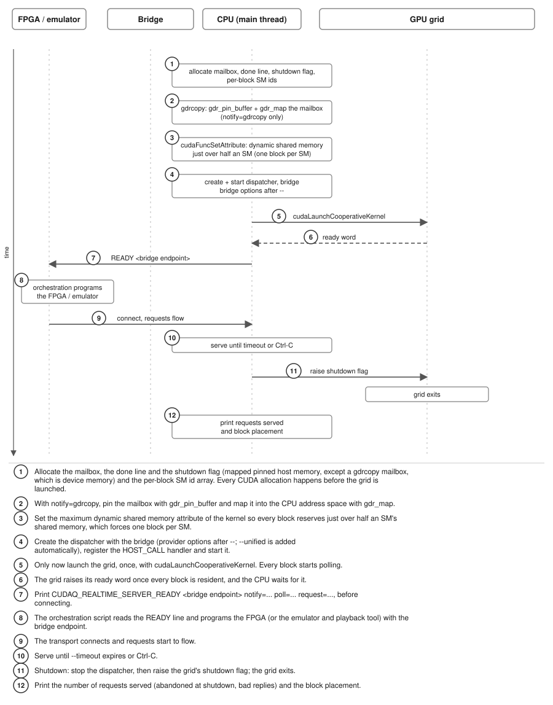
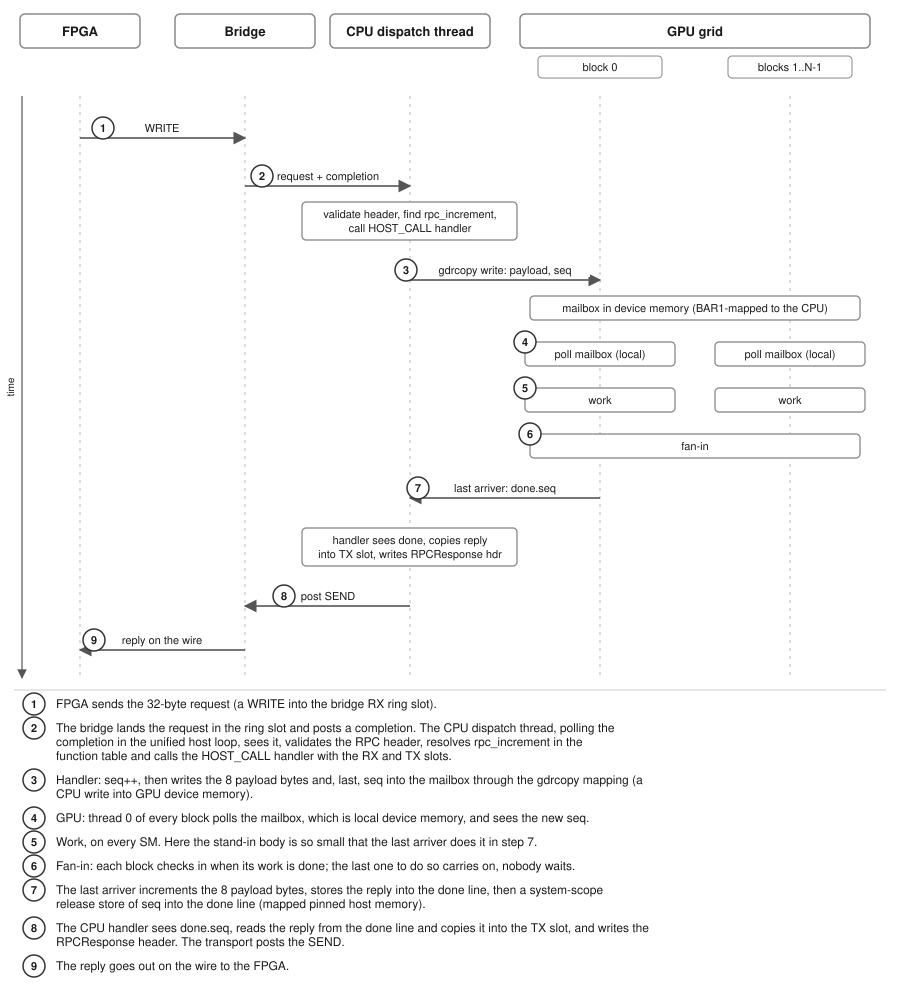
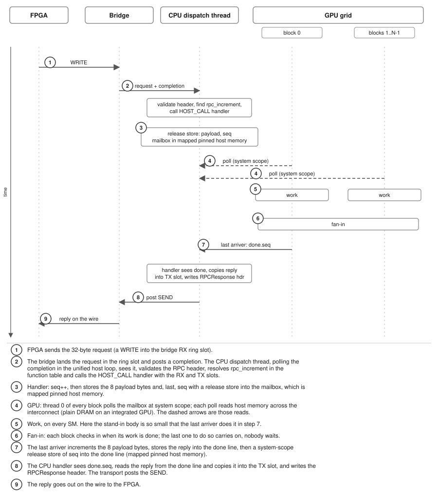
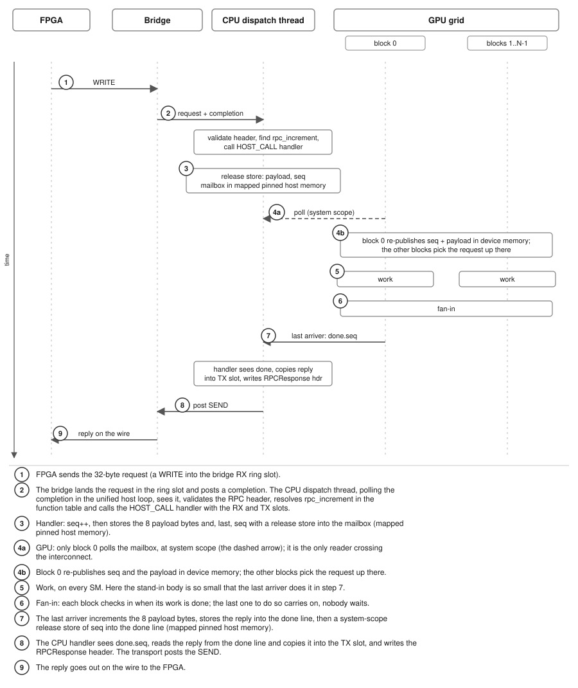
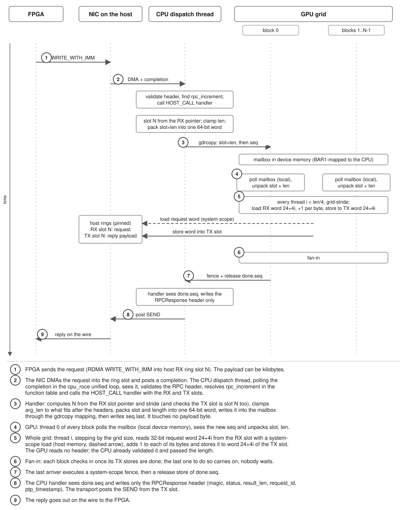

# GPU Grid Dispatch Example

The `gpu_grid_dispatch` example answers each RPC request with a whole resident
cooperative GPU grid, using the lowest-latency handoff we found for each
platform. It lives in `realtime/examples/gpu_grid_dispatch`.

## Overview

The grid stands in for a decoder, or any other control kernel that owns the
device: one block per SM, every SM, nothing else running on the GPU. It is
launched once, before the transport connects, with
`cudaLaunchCooperativeKernel`, and then waits for work.

The CPU owns the NIC. The CUDA-Q Realtime host dispatch path
(single-thread unified loop: NIC receive, dispatch, send) runs over the
`cpu_roce` bridge, a CPU RoCE transceiver whose rings live in host memory.
A `CUDAQ_DISPATCH_HOST_CALL` handler wakes the prelaunched grid through a
mailbox and waits on a done word in mapped pinned host memory.

Where the request and reply bytes travel is selected by `--request`:

- `inline` (the default): the GPU does not touch the NIC rings. The `cpu_roce`
  rings are host allocations registered with the NIC but not with CUDA, so
  the handler copies the 8 request payload bytes into the mailbox, and the grid
  returns the 8 reply bytes through a done line in mapped pinned host memory.
  The CPU handler copies the reply from the done line into the TX slot, writes
  the `RPCResponse` header, and the transport sends it. This is the fast path
  for a few bytes.
- `ring`: at startup the example registers the bridge's RX and TX rings with
  CUDA, so the grid reads the request where the NIC wrote it and writes the
  reply payload straight into the paired TX slot. The CPU touches no payload
  bytes: it passes the slot index and the length through the mailbox and
  writes only the `RPCResponse` header afterwards. This is the shape for a
  payload as large as the slot stride minus 24 bytes (kilobytes of syndrome
  data), where copying through the CPU is the wrong design. See
  [Ring requests](#ring-requests-the-grid-reads-the-slot-in-place).

Request and reply use the standard `rpc_increment` RPC:

- In: a 24-byte `RPCHeader` followed by the payload (8 bytes; with
  `--request=ring`, up to the slot size minus 24).
- Out: a 24-byte `RPCResponse` followed by the same bytes, each incremented
  by one.

The grid's work is deliberately that increment, and the request ends with a
fan-in instead of a grid-wide barrier: once a block's work is done, its thread
0 adds one to an arrival counter in device memory with an acquire-release
atomic at GPU scope, and the block whose add completes the count for this
request is the last arriver. It alone executes a system-scope fence and the
release store of `seq` into the done line. In inline mode the stand-in work is
so small that the last arriver does it too: it increments the 8 payload bytes
it read from the mailbox and stores the reply as one 8-byte word into the done
line just before `seq`; every other thread stands in for a real decoder's work
and does nothing. In ring mode the whole grid increments the bytes in place, a
32-bit word per thread (see below), before arriving. No block waits for any
other, and `grid.sync()` is used only once, at startup, to report placement and
raise the ready flag. Every block reserves just over half of an SM's shared
memory as dynamic shared memory, so occupancy is exactly one block per SM.

Three switches select the handoff, and `auto` picks per platform for the first
two (the program prints its choice):

- `--notify=gdrcopy|pinned|auto`: how the CPU writes the mailbox.
  - `gdrcopy`: the mailbox is device memory, pinned and mapped into the CPU
    address space with `gdrcopy` (`gdr_pin_buffer`, `gdr_map`). The GPU polls
    local memory and the CPU's writes cross the interconnect.
  - `pinned`: the mailbox is mapped pinned host memory, written by the CPU with
    a release store. The GPU polls it at system scope, so every poll crosses
    the interconnect (C2C on GH200, PCIe on a discrete GPU, plain DRAM on an
    integrated GPU).
- `--poll=all|leader|auto`: who polls the mailbox on the GPU.
  - `all`: thread 0 of every block polls the mailbox.
  - `leader`: only block 0 thread 0 polls. It copies the request field into a
    device-memory broadcast line and then publishes `seq` there with a
    GPU-scope release store; thread 0 of every other block spins on that `seq`
    with GPU-scope acquire loads and picks the request up from device memory.
    The mailbox carries only `seq` and that field (the 8 payload bytes inline,
    the packed slot and length in ring mode). This costs one extra device-memory
    hop per request, but only one poller crosses the interconnect.
- `--request=inline|ring`: where the request and reply bytes travel (see
  above). It is never chosen automatically: `inline` is the default and `ring`
  is always explicit.

The mailbox is one 128-byte line, `{seq, payload (inline), slot_len (ring)}`;
the done line is `{seq, reply (inline only), ready}`.

## Why a CPU-owned NIC and a resident grid

A resident grid avoids a kernel launch per request: the cost of waking it is
one write and one poll. Keeping the NIC under CPU control keeps the transport
simple and portable. The same binary runs on any platform with a ConnectX NIC
and a CUDA GPU, with no GPU-side networking stack, and the only platform
dependent part is how the CPU tells the grid that a request has arrived. That
is the part the two switches select.

The ring stays in host memory on every platform, because the CPU owns the NIC
in this design. The choice of handoff is therefore only about the mailbox and
about how the grid polls it, never about where the ring lives.

## The three handoffs

All variants share the same setup, shown first, and the same nine per-request
steps. They differ in steps 3 and 4: how the CPU writes the mailbox and how
the grid notices. The three figures below are for `--request=inline`;
[Ring requests](#ring-requests-the-grid-reads-the-slot-in-place) describes what
changes with `--request=ring`.

### Setup, serve and shutdown

Everything that allocates CUDA memory, and the dispatcher, are set up before
the grid is launched, because a resident cooperative grid blocks later
allocations in the process. The READY line is printed before the transport
connects.



1. Allocate the mailbox, the done line and the shutdown flag (mapped pinned host
   memory, except a gdrcopy mailbox, which is device memory) and the per-block SM
   id array. With `request=ring`, also register the bridge's RX and TX rings
   with CUDA (see [Ring requests](#ring-requests-the-grid-reads-the-slot-in-place));
   this too happens before the grid is launched.
2. With `notify=gdrcopy`, pin the mailbox with `gdr_pin_buffer` and map it into
   the CPU address space with `gdr_map`.
3. Set the maximum dynamic shared memory attribute of the kernel so every block
   reserves just over half an SM's shared memory, which forces one block per
   SM.
4. Create the dispatcher with the `cpu_roce` bridge (`--qp_config=hsb_fpga
   --peer-ip --remote-qp`; `--unified` is added automatically), register the
   `HOST_CALL` handler and start the dispatcher.
5. Only now launch the grid, once, with `cudaLaunchCooperativeKernel`. Every
   block starts polling.
6. The grid raises its ready word once every block is resident, and the CPU
   waits for it.
7. Print `CUDAQ_REALTIME_SERVER_READY <endpoint> notify=... poll=... request=...`
   before connecting.
8. The orchestration script reads the READY line and programs the FPGA (or the
   emulator and playback tool) with `qp`, `rkey` and `buffer_addr`.
9. The transport connects and requests start to flow.
10. Serve until `--timeout` expires or Ctrl-C.
11. Shutdown: stop the dispatcher, then raise the grid's shutdown flag; the grid
    exits. In ring mode the rings are then unregistered from CUDA, before the
    bridge releases them.
12. Print the number of requests served (abandoned at shutdown, bad replies)
    and the block placement.

### gdrcopy notify, all blocks poll

Selected with `--notify=gdrcopy --poll=all`.



1. FPGA sends the 32-byte request (RDMA `WRITE_WITH_IMM` into the host ring
   slot).
2. The NIC DMAs the request into the ring slot and posts a completion. The CPU
   dispatch thread, polling the completion in the `cpu_roce` unified loop, sees
   it, validates the RPC header, resolves `rpc_increment` in the function table
   and calls the `HOST_CALL` handler with the RX and TX slots.
3. Handler: `seq++`, then writes the 8 payload bytes and, last, `seq` into the
   mailbox through the gdrcopy mapping (CPU writes into GPU device memory).
4. GPU: thread 0 of every block polls the mailbox, which is local device memory,
   and sees the new `seq`.
5. The grid does its work on every SM. Here the stand-in body is so small
   that it is folded into step 7.
6. Fan-in: thread 0 of every block adds one to an arrival counter in device
   memory (an acquire-release atomic at GPU scope). Nobody waits.
7. The block whose add completes the count increments the 8 payload bytes and
   stores the reply as one 8-byte word into the done line (mapped pinned host
   memory), then executes a system-scope fence and a release store of `seq`.
8. The CPU handler sees `done.seq`, reads the reply from the done line and
   copies it into the TX slot, and writes the `RPCResponse` header. The
   transport posts the SEND.
9. The reply goes out on the wire to the FPGA.

### Pinned notify, all blocks poll

Selected with `--notify=pinned --poll=all`.



1. FPGA sends the 32-byte request (RDMA `WRITE_WITH_IMM` into the host ring
   slot).
2. The NIC DMAs the request into the ring slot and posts a completion; the CPU
   dispatch thread sees it, validates the RPC header, resolves `rpc_increment`
   and calls the `HOST_CALL` handler with the RX and TX slots.
3. Handler: `seq++`, then stores the 8 payload bytes and, last, `seq` with a
   release store into the mailbox, which is mapped pinned host memory.
4. GPU: thread 0 of every block polls the mailbox at system scope. Each poll
   reads host memory across the interconnect (plain DRAM on an integrated GPU).
   The dashed arrows in the figure are those reads.
5. The grid does its work on every SM. Here the stand-in body is so small
   that it is folded into step 7.
6. Fan-in: thread 0 of every block adds one to an arrival counter in device
   memory (an acquire-release atomic at GPU scope). Nobody waits.
7. The block whose add completes the count increments the 8 payload bytes and
   stores the reply as one 8-byte word into the done line (mapped pinned host
   memory), then executes a system-scope fence and a release store of `seq`.
8. The CPU handler sees `done.seq`, reads the reply from the done line and
   copies it into the TX slot, and writes the `RPCResponse` header. The
   transport posts the SEND.
9. The reply goes out on the wire to the FPGA.

### Pinned notify, leader polls

Selected with `--notify=pinned --poll=leader`.



1. FPGA sends the 32-byte request (RDMA `WRITE_WITH_IMM` into the host ring
   slot).
2. The NIC DMAs the request into the ring slot and posts a completion; the CPU
   dispatch thread sees it, validates the RPC header, resolves `rpc_increment`
   and calls the `HOST_CALL` handler with the RX and TX slots.
3. Handler: `seq++`, then stores the 8 payload bytes and, last, `seq` with a
   release store into the mailbox (mapped pinned host memory).
4. GPU, in two parts:
   - 4a. Only block 0 polls the mailbox, at system scope (the dashed arrow).
     It is the only reader crossing the interconnect.
   - 4b. Block 0 re-publishes the request in device memory: it copies the
     payload into a broadcast line, then publishes `seq` there with a
     GPU-scope release store. Thread 0 of every other block spins on that
     `seq` with GPU-scope acquire loads and reads the payload from the line.
5. The grid does its work on every SM. Here the stand-in body is so small
   that it is folded into step 7.
6. Fan-in: thread 0 of every block adds one to an arrival counter in device
   memory (an acquire-release atomic at GPU scope). Nobody waits.
7. The block whose add completes the count increments the 8 payload bytes and
   stores the reply as one 8-byte word into the done line (mapped pinned host
   memory), then executes a system-scope fence and a release store of `seq`.
8. The CPU handler sees `done.seq`, reads the reply from the done line and
   copies it into the TX slot, and writes the `RPCResponse` header. The
   transport posts the SEND.
9. The reply goes out on the wire to the FPGA.

Any combination of the two switches is accepted; `auto` only ever selects the
three above.

### Ring requests: the grid reads the slot in place

Selected with `--request=ring`, together with any `--notify` and `--poll`
combination. There is no separate figure for the waking part: steps 3 and 4
are the same as in the handoff you chose. The figure shows the gdrcopy and
all-poll case.



The point of this mode: an RPC payload can be as large as the slot stride minus
24 bytes (kilobytes of syndrome data), and copying that through the CPU is the
wrong shape. Here the grid reads the request where the NIC wrote it and writes
the reply payload into the TX slot the transport will send from. The CPU
touches no payload byte. Inline stays the fast path for a few bytes.

At startup, before the dispatcher and the grid are created, the example gets
the `cpu_roce` bridge's RX and TX ring base addresses and strides from
`cudaq_bridge_get_cpu_dataplane` and the slot count from
`cudaq_bridge_get_ring_geometry`, registers both rings with CUDA
(`cudaHostRegister`, mapped and portable) and takes the device pointers. The
rings are unregistered at shutdown. The ring stays in host memory: the CPU owns
the NIC.

Per request:

1. FPGA sends the request (RDMA `WRITE_WITH_IMM` into host RX ring slot N). The
   payload can be kilobytes.
2. The NIC DMAs it into the ring slot and posts a completion; the CPU dispatch
   thread sees it, validates the RPC header, resolves `rpc_increment` and calls
   the `HOST_CALL` handler with the RX and TX slots.
3. Handler: computes the RX slot index from the slot pointer and the stride and
   checks that the TX slot pairs with it (the unified shape pairs slot N on
   both rings), clamps the request's `arg_len` to what fits in a slot after the
   24-byte headers, packs slot and length into one 64-bit mailbox word
   (`slot_len`), then writes `seq` with release semantics (with gdrcopy: two
   copies, `slot_len` then `seq`).
4. GPU: woken exactly as in inline mode, by every block polling (`poll=all`) or
   by the leader (`poll=leader`, whose broadcast line carries the packed word).
   Every thread unpacks slot and length.
5. The whole grid runs a grid-stride loop over 32-bit words: thread `i` reads
   request word `i` (bytes `24+4i..24+4i+3`) from the RX slot with one
   system-scope load of host memory (the dashed arrow), adds one to each of its
   four bytes, and stores the word to the same offset of the TX slot (host
   memory, the solid arrow). A trailing partial word is handled byte by byte.
6. Fan-in: once its threads are done, each block's thread 0 adds one to the
   arrival counter in device memory (acquire-release, GPU scope), so the last
   arriver has observed every block's TX-slot stores.
7. The last arriver executes a system-scope fence, then the release store of
   `done.seq`.
8. The CPU handler sees `done.seq` and writes only the `RPCResponse` header
   (magic, status, `result_len` = the clamped length, `request_id`,
   `ptp_timestamp` echoed). The transport posts the SEND from the TX slot.
9. The reply goes out on the wire to the FPGA.

The GPU reads no header. That was measured to cost two dependent host-memory
reads per request, so the CPU, which has already validated the header, passes
the length instead.

Platforms: on GH200 and GB200 (C2C), a Thor iGPU and a DGX Spark (shared DRAM)
the GPU has a coherent mapping of the host ring. On a PCIe discrete GPU such as
the RTX PRO 6000 the reads cross PCIe, which is correct but slow; a
device-memory RX ring (`DMA-BUF`) in the `cpu_roce` bridge would help there and
is future work.

## Choosing automatically

With `--notify=auto --poll=auto` (the defaults) the program picks per platform
and prints its choice in a line such as:

```text
handoff: notify=gdrcopy (auto) poll=all (auto); discrete GPU, 132 SMs
```

The parentheses say whether each value came from `auto` or from a flag. The
rule is:

1. Integrated GPU (`cudaDevAttrIntegrated`, for example the iGPU of an IGX Thor
   that shares DRAM with the CPU): `notify=pinned`, `poll=all`.
2. Otherwise, if the build has gdrcopy and the `gdrdrv` mapping succeeds (for
   example GH200): `notify=gdrcopy`, `poll=all`.
3. Otherwise (a discrete GPU over PCIe, such as an IGX Thor with an RTX PRO
   6000, or a DGX Spark GB10 where gdrcopy is unavailable): `notify=pinned`,
   `poll=leader`. If gdrcopy was tried and failed, the program prints an extra
   `gdrcopy not used: <reason>` line.

With `--poll=auto` the poll mode follows the notify mode that was chosen, even
when `--notify` was given explicitly: `all` on an integrated GPU or with a
gdrcopy mailbox, `leader` otherwise. So `--notify=pinned` on a discrete GPU
gets `leader`. An explicit `--poll=` is honored as given.

Why each choice wins:

- **GH200 (gdrcopy, all).** The GPU's read of host memory over C2C is the
  expensive hop. Putting the token in GPU memory lets every block poll local
  memory, and the CPU pays for a single write into the mailbox.
- **Integrated GPU (pinned, all).** The CPU and the GPU use the same DRAM, so
  there is no interconnect to cross and having every block poll the mailbox
  costs nothing extra. The simplest handoff is also the best one.
- **PCIe GPU or no gdrcopy (pinned, leader).** With 100 or more blocks polling
  host memory, the polling traffic saturates the link and the request itself
  suffers. One poller plus a device-side broadcast keeps a single reader on the
  link, at the price of one more device-memory hop.

`--request` is never chosen automatically: `inline` is the default, and `ring`
is only used when asked for. The `auto` rules above apply to `--notify` and
`--poll` in either request mode.

The ring stays in host memory on every platform, because the CPU owns the NIC
in this design.

## Building

The example is a standalone CMake project, like the other examples. It needs a
CUDA-Q Realtime install (see [building.md](building.md) for how it is
produced):

```bash
cmake -S realtime/examples/gpu_grid_dispatch -B build \
      -DCUDAQ_REALTIME_ROOT=<install> -DCMAKE_CUDA_ARCHITECTURES=90
cmake --build build
```

Use the architecture of your GPU for `CMAKE_CUDA_ARCHITECTURES` (for example 90
for GH200, 100, 110 or 120 for newer parts).

gdrcopy is detected automatically through `GDRCOPY_HOME`, `/usr/local/gdrcopy`
or `/opt/gdrcopy`. A build without gdrcopy is fully functional but cannot use
`notify=gdrcopy`: a run that asks for `--notify=gdrcopy` on such a build, or
where the gdrdrv mapping fails, exits with an error naming the reason, while
`auto` falls back to `pinned`.

### Installing gdrcopy

[gdrcopy](https://github.com/NVIDIA/gdrcopy) is a kernel module (`gdrdrv`) plus
a user-space library (`libgdrapi`) that lets the CPU map GPU memory (through
the GPU's BAR1 aperture) and read or write it directly. Treat the gdrcopy
README as the authority on version-specific details.

Prerequisites:

- Kernel headers for the running kernel and a compiler toolchain.
- The CUDA toolkit (the examples below use `/usr/local/cuda`).
- A GPU and driver combination that supports BAR1 mapping. This is not
  available on integrated Tegra GPUs, or wherever the driver forbids it. In
  those cases use `notify=pinned`.

Steps:

```bash
# 1. Build and install the library and the tests
git clone https://github.com/NVIDIA/gdrcopy.git
cd gdrcopy
make prefix=/usr/local/gdrcopy CUDA=/usr/local/cuda all install

# 2. Build and load the kernel module
cd src/gdrdrv && make && sudo insmod gdrdrv.ko
```

The repository also ships an `insmod.sh` helper and DEB/RPM packaging under
`packages/`; either can be used instead of the manual `insmod` (see the gdrcopy
README).

Verify:

```bash
lsmod | grep gdrdrv      # module loaded
ls -l /dev/gdrdrv        # device node present
gdrcopy_sanity           # or: gdrcopy_copybw
```

(The tests are installed under the `prefix` used above; add its `bin` and
`lib` directories to `PATH` and `LD_LIBRARY_PATH` if they are not found.)

In a container, the module is loaded on the host and the device node
`/dev/gdrdrv` must be passed into the container (for example with
`--device=/dev/gdrdrv`).

Then build the example against it:

```bash
GDRCOPY_HOME=/usr/local/gdrcopy \
cmake -S realtime/examples/gpu_grid_dispatch -B build \
      -DCUDAQ_REALTIME_ROOT=<install> -DCMAKE_CUDA_ARCHITECTURES=90
cmake --build build
```

## Running

### With the FPGA

Set up the HSB FPGA as described in the
[CUDA-Q Realtime installation docs](https://nvidia.github.io/cuda-quantum/latest/using/realtime/installation.html#realtime-hsb-fpga-artifacts)
and in [nvqlink_latency_demo.md](nvqlink_latency_demo.md) (program the bit-file,
configure the NIC address). Then use the orchestration script in the example
directory, a sibling of `realtime/unittests/cpu_transport/hsb_test_cpu.sh`:

```bash
gpu_grid_dispatch_test.sh --fpga-ip 192.168.0.2
gpu_grid_dispatch_test.sh --fpga-ip 192.168.0.2 --notify pinned --poll leader
gpu_grid_dispatch_test.sh --fpga-ip 192.168.0.2 --request ring \
    --page-size 4096 --payload-size 1000
```

The script starts `gpu_grid_dispatch`, waits for the
`CUDAQ_REALTIME_SERVER_READY` line and hands `qp`, `rkey` and `buffer_addr` to
the `hsb_fpga_playback` tool, which programs the FPGA, drives the requests and
verifies the replies. It does not set up the network: run
`hsb_test_cpu.sh --setup-network` first (same addresses).

### With the emulator

```bash
gpu_grid_dispatch_test.sh --emulate
```

`--emulate` runs `hsb_fpga_emulator` and `hsb_fpga_playback` in place of the
FPGA. They come from a CUDA-Q Realtime build with the HSB tools enabled
(`CUDAQ_REALTIME_ENABLE_HSB_TOOLS=ON`); point `--bin-dir` at its
`unittests/utils` directory. The rest of the flow is identical.

A ring-mode run with a kilobyte payload:

```bash
gpu_grid_dispatch_test.sh --emulate --request ring \
    --page-size 4096 --payload-size 1000 --num-messages 32
```

Notes on `--request`, `--payload-size` and `--page-size`:

- `--request` is `inline` (default) or `ring`. Inline answers only the first 8
  payload bytes (the script prints a note if `--payload-size` is larger); ring
  answers all of them, up to the page size minus 24.
- `--page-size` is the ring slot size (default 384). Raise it with
  `--payload-size`: the script exits with an error when payload + 24 exceeds
  the page size.
- The playback BRAM holds 512 lines of 64 bytes in all, so
  `num-messages x ceil((24 + payload) / 64) <= 512`. The script exits with an
  error, and the largest `--num-messages` that fits, when the messages do not
  fit. The response capture checks the first 40 bytes.

The script's own options are:

```text
--emulate  --bin-dir DIR  --cuda-quantum-dir DIR  --example-bin PATH
--bridge PATH
--device DEV  --bridge-ip ADDR  --emulator-ip ADDR  --fpga-ip ADDR  --fpga-qp QP
--gpu N  --notify MODE  --poll MODE  --request MODE  --blocks N  --threads N
                                                        (passed through)
--timeout N  --no-verify  --num-messages N  --payload-size N  --page-size N
--num-pages N  --frame-size N  --control-port N  --save-temps
```

See `gpu_grid_dispatch_test.sh --help` for defaults.

### Command line

```text
Usage: gpu_grid_dispatch [options] [-- <cpu_roce bridge options>]

Serves rpc_increment with a resident cooperative GPU grid; the CPU
owns the NIC through the cpu_roce bridge (unified host loop).

  --gpu=N                        CUDA device [0]
  --notify=auto|gdrcopy|pinned   CPU -> GPU mailbox [auto]
  --poll=auto|all|leader         who polls the mailbox [auto]
  --request=inline|ring          where request/reply bytes travel:
                                 8 bytes via mailbox/done line, or
                                 the grid reads the RX slot and
                                 writes the TX slot [inline]
  --blocks=N                     grid blocks [SM count]
  --threads=N                    threads per block [256]
  --timeout=S                    stop after S s, 0 = never [0]
  --bridge=PATH                  bridge provider .so [cpu_roce]

Bridge options after --, e.g. --device=mlx5_0 --qp_config=hsb_fpga
--peer-ip=A --remote-qp=N --num-slots=64 --slot-size=4096
--frame-size=32 (--unified is added if missing).
```

When `--bridge` is not given, the `libcudaq-realtime-bridge-cpu-roce.so` next
to the CUDA-Q Realtime install the example was built against is used. Other
bridge options include `--local-ip=A`.

Example, by hand:

```bash
./gpu_grid_dispatch --timeout=60 -- \
    --device=mlx5_0 --local-ip=192.168.0.101 --qp_config=hsb_fpga \
    --peer-ip=192.168.0.2 --remote-qp=<qp>
```

### What the output looks like

At startup the program prints the handoff decision (see
[Choosing automatically](#choosing-automatically)), a grid summary and then the
line the orchestration script waits for (the `request=` field names the
request mode):

```text
handoff: notify=gdrcopy (auto) poll=all (auto) request=inline; discrete GPU, 132 SMs
grid: 132 blocks x 256 threads, 117760 B dynamic shared memory per block; bridge: 64 slots of 4096 B
CUDAQ_REALTIME_SERVER_READY transport=cpu_roce qp_config=hsb_fpga peer_ip=192.168.0.1 qp=0xe25 rkey=18429 buffer_addr=0x0 notify=gdrcopy poll=all request=inline
```

(Output of a GH200 run.) The bridge endpoint part carries the `qp`, `rkey` and
`buffer_addr` that the FPGA (or the emulator) needs to write into the host
ring; the script parses them out of this line. The program then serves until
the timeout or Ctrl-C.

With `--request=ring` the grid line gains the ring mapping and the READY line
ends in `request=ring`:

```text
handoff: notify=gdrcopy (auto) poll=all (auto) request=ring; discrete GPU, 132 SMs
grid: 132 blocks x 256 threads, 117760 B dynamic shared memory per block; bridge: 64 slots of 4096 B; rings: rx 64 x 4096 B, tx 64 x 4096 B, mapped for the GPU
CUDAQ_REALTIME_SERVER_READY transport=cpu_roce qp_config=hsb_fpga peer_ip=192.168.0.1 qp=0xe25 rkey=18429 buffer_addr=0x0 notify=gdrcopy poll=all request=ring
```

## Shutdown and diagnostics

On timeout (`timeout reached (S s)` is printed) or Ctrl-C, the program stops
the dispatcher, raises the grid's shutdown flag so the resident grid exits, and
prints:

```text
requests served: N (abandoned at shutdown: K; bad replies: B)
placement: N blocks on M distinct SMs (of S)
```

`abandoned` counts requests that were handed to the grid but answered with an
error status because shutdown began before the grid replied. `bad replies`
counts replies whose first (up to 8) result bytes were not the argument bytes
plus one: the handler checks them with one 8-byte read per request, which is
what ties the fan-in's release and acquire chain to an observable result. It
should be 0. In ring mode the served line also carries `unpaired slots: N`:
the number of requests whose RX and TX slots did not pair up (same index,
within the ring), which are answered with an error status instead of being
handed to the grid. It should be 0; the first occurrence also prints an
`ERROR: request slots do not pair up` line. The placement
line reports how many distinct SMs the blocks ran on; for the intended
residency (one block per SM on every SM) `M` equals the number of blocks and
`S`. A smaller `M` means blocks shared SMs.

If `--notify=gdrcopy` fails with a gdrcopy error, check the build (see
[Installing gdrcopy](#installing-gdrcopy)), `lsmod | grep gdrdrv` and
`/dev/gdrdrv`, or pass `--notify=pinned`.

If `--request=ring` fails with `cannot map the bridge's RX ring` (or `TX`), the
GPU could not `cudaHostRegister` the memory the NIC driver allocated; use
`--request=inline` on that platform.

## Limitations

- The ring is in host memory. The CPU owns the NIC through `cpu_roce`, and
  there is no device-resident ring with that bridge. With `--request=inline`
  the rings are not registered with CUDA, so the GPU can neither read the
  request from the ring nor write the reply into the TX slot: the payload goes
  through the mailbox and the reply comes back through the done line, with the
  CPU doing both copies. With `--request=ring` the GPU does read and write the
  rings, through a CUDA mapping of the host memory. That mapping is coherent
  and fast on GH200/GB200 (C2C), the Thor iGPU and DGX Spark (shared DRAM). On
  a PCIe discrete GPU such as the RTX PRO 6000 every ring access crosses PCIe:
  correct but slow, and a device-memory RX ring (`DMA-BUF`) in the `cpu_roce`
  bridge is future work.
- The cooperative grid occupies the whole GPU: one block per SM on every SM,
  with shared memory sized to force it. Nothing else can run on that GPU while
  the example is up.
- One request is in flight at a time: the handler waits for the done word
  before returning, so the next request is not processed until the reply has
  been copied into the TX slot.
- The work done on the grid is a stand-in (an increment of each payload byte).
  A real control kernel replaces the body between the poll and the fan-in; it
  may add a grid-wide barrier if its own work needs one.
- With `--request=inline` the handler serves up to 8 argument bytes. With
  `--request=ring` it serves up to the slot size minus 24 bytes (the length is
  clamped, and `result_len` reports what was served).
