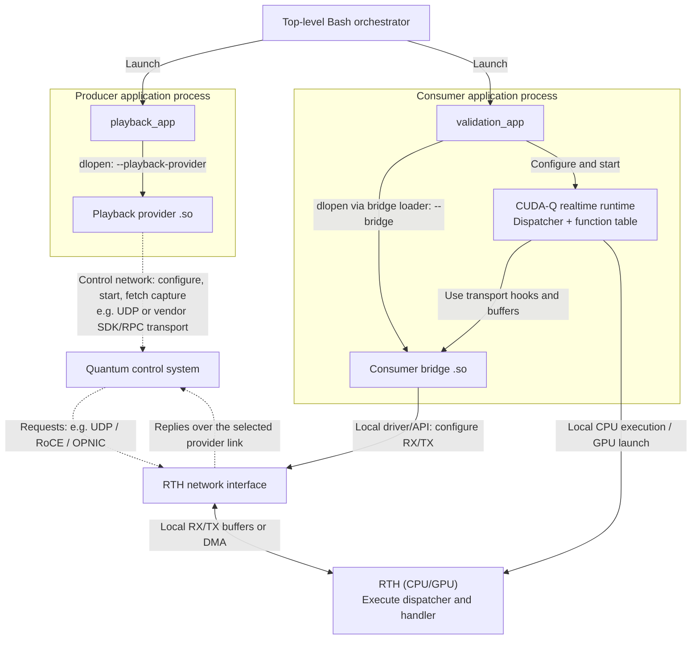
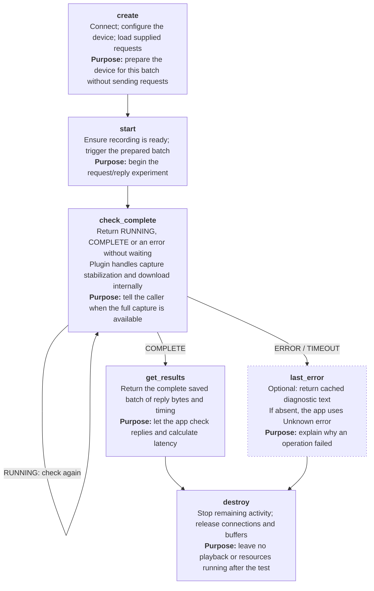

# Universal realtime validation architecture

## Purpose and scope

This document describes the validation architecture for different control-system
and networking solutions used with CUDA-Q realtime, focusing on the producer side
and its integration with the realtime host (`RTH`). Each solution uses a playback
provider plugin and a compatible `RTH` bridge, reusing an existing bridge where its
data-plane protocol matches. The same applications define the workload, verify
responses and calculate measurements across solutions.

The playback provider interface is control-plane oriented: it prepares a finite batch,
starts playback, retrieves recorded replies and releases resources.
Hardware, a controller program or a provider-owned worker performs the packet
exchange. Application polling must not control packet timing.

The canonical workload is RPC increment: the `RTH` increments each payload byte
modulo 256 and returns it. The same applications run with CPU or GPU dispatch;
CPU execution does not require a visible GPU, but plugin dependencies still
apply: HSB playback requires `libcuda.so.1`, and CPU RoCE requires
`libibverbs`. The selected bridge must supply
the rings or transport hooks needed by that execution path. Separate dispatch
is the default; unified dispatch is selected explicitly. Native forwarding is
a separate baseline that echoes requests without invoking the RPC handler.
Each report identifies the execution path, dispatch mode and workload so their
measurements can be compared deliberately.

For run commands, see the [installation guide](user_guide.md#setup) or
[local build guide](building.md). The [message protocol](cudaq_realtime_message_protocol.md)
defines the shared RPC encoding.

## Architecture and responsibilities

### Applications, shared libraries and hardware

The Bash runner starts two application processes. Each app loads its provider
library into its own process with `dlopen`; the `.so` is not a separate process.
The consumer uses the bridge loader to perform that dynamic loading.



In this component diagram, dotted arrows are network links. The control link
configures the quantum control system and retrieves capture; the request/reply
link is the path being validated, for example `UDP`, RoCE or `OPNIC`. These links
may use different transports. A software test source uses local control in
place of the external controller's control-network link.

Solid arrows show process launch, library loading, local API/driver calls and
local buffer or `DMA` access. RX/TX buffer placement depends on the bridge and
CPU/GPU mode; the diagram does not require a particular `DMA` path. Native
forwarding uses the bridge's forwarding path without the dispatcher.

The runner transfers the `RTH`'s opaque endpoint and coordinates readiness
before playback starts. Results and logs return to the runner; request/reply
traffic travels between the quantum control system and the `RTH` networking
path. The provider mappings below give examples of device-control actions.

### Component responsibilities

| Component | Responsibility |
| --- | --- |
| Top-level Bash runner | Select cases (**examples:** CPU separate-dispatch increment, GPU unified-dispatch increment, native forwarding) and plugins; launch processes; transfer the opaque endpoint; coordinate readiness; enforce process deadlines; preserve results and clean up. |
| `playback_app` | Generate canonical requests; supply run settings; check completion; retrieve the batch; verify all replies; print raw `RTT` measurements and their clock scale; calculate statistics. |
| Playback provider | Adapt the control API to the device or SDK; stage requests; trigger playback; apply completion rules; return captured reply bytes and timing; manage resources. |
| Quantum control system | Send staged requests and capture replies independently of application polling. **Examples:** an HSB FPGA player with on-chip capture, or a `UDP` send/receive worker acting as a control-system test source. |
| `validation_app` | Load the consumer bridge; register the function table; configure and start CPU/GPU execution; report endpoint and readiness. |
| Consumer bridge | Map the provider transport to realtime RX/TX and dispatcher interfaces; implement native forwarding where supported. |
| Realtime dispatcher | Invoke the selected handler and return its result through the bridge. |

### Playback provider control-plane lifecycle

Each plugin implements the same finite-batch device-control path. The caller
supplies the request batch, `RTH` endpoint, provider options, run timeout and quiet
period. Playback and capture progress independently of application status checks.



`check_complete` may be called while playback is running. It reads cached status;
playback, capture and result download progress independently. COMPLETE means all
captured replies are ready for the app to verify. The API below defines input
ownership, result lifetime and cleanup after failures.

#### C API and parameter contract

The declarations below are function-pointer members of
`cudaq_playback_provider_interface_t`, called through the loaded table, for
example `api->start(provider)`. They are not separate exported functions.
[playback_provider_interface.h](../include/cudaq/realtime/validation/playback_provider_interface.h)
is the C declaration source. One handle owns one batch; calls on that handle
are serialized, and C++ exceptions must not cross the ABI. Caller and provider
must agree on the target architecture and C layout.

```c
typedef void *cudaq_playback_provider_t;
typedef int32_t cudaq_playback_provider_status_t;

enum {
    CUDAQ_PLAYBACK_PROVIDER_OK = 0,
    CUDAQ_PLAYBACK_PROVIDER_RUNNING = 1,
    CUDAQ_PLAYBACK_PROVIDER_COMPLETE = 2,
    CUDAQ_PLAYBACK_PROVIDER_ERROR = 3,
    CUDAQ_PLAYBACK_PROVIDER_TIMEOUT = 4
};
```

Compare named status codes explicitly; RUNNING and COMPLETE apply only to
`check_complete`.

OK means the API call succeeded. `check_complete` returns RUNNING while the run
is in progress and COMPLETE when the captured replies are ready to read.
The app then checks the replies before reporting PASS or FAIL.
ERROR means invalid input, a call made at the wrong time, or an execution failure.
TIMEOUT means the time limit expired. Use `last_error`, if provided, to read the
error message.

Control durations use `uint64_t` nanoseconds: setup/run/cleanup timeouts, request
spacing and capture quiet periods. For example, 1 second = 1,000,000,000 nanoseconds.
`RTT` measurements use integer clock ticks with an exact rational seconds-per-tick
scale shared by the batch.
Providers convert to SDK or device units internally and reject unsupported values.
The reference providers reject durations above `INT64_MAX` nanoseconds.

##### `create` — create and configure a playback instance

```c
cudaq_playback_provider_status_t (*create)(
    int argument_count,
    const char *const *arguments,
    const cudaq_playback_provider_create_params_t *params,
    uint64_t setup_timeout_ns,
    cudaq_playback_provider_t *out_provider);
```

| Parameter | C type | Direction | Purpose and rules | Example |
| --- | --- | --- | --- | --- |
| `argument_count` | `int` | Input | Number of provider argument strings. Must be nonnegative; zero means no provider options. | `0` (HSB needs none) |
| `arguments` | `const char *const *` | Input | Exactly `argument_count` provider strings, excluding the executable name and `--` separator. Each string is non-NULL and `NUL`-terminated. The array itself may be NULL when the count is zero; no terminating NULL entry is required. Forwarded unchanged for settings absent from `params` and the `RTH` endpoint. They must not duplicate or override the workload, pacing, capture period, deadlines or published connection settings. Syntax belongs to the provider; `UDP` accepts `--host=192.168.0.10`. | `NULL` (HSB needs none) |
| `params` | `const cudaq_playback_provider_create_params_t *` | Input | Required pointer to the endpoint, canonical requests and common run settings described below. The plugin copies all inputs it needs before returning, including on failure. | `&params`, filled with the fields below |
| `setup_timeout_ns` | `uint64_t` | Input | Positive setup budget in nanoseconds, measured from entry into create. Covers argument validation, input copying and device/SDK preparation. It is independent of the run deadline. | `30000000000` (30 seconds for setup) |
| `out_provider` | `cudaq_playback_provider_t *` | Output | Required writable pointer to handle storage. The plugin sets it to NULL first. OK returns a non-NULL prepared handle. ERROR/TIMEOUT may return a partial handle that must be destroyed. | `&provider`, with `provider` initialized to NULL |

**Return:** OK when preparation succeeds without sending test requests; ERROR
for invalid inputs, unsupported settings or setup failure; TIMEOUT when the
setup budget expires. All caller input memory may be released after return.
The returned handle remains plugin-owned until successful destroy.

###### Create parameter fields

```c
typedef struct {
    const char *rth_endpoint;
    const uint8_t *requests;
    size_t request_size_bytes;
    size_t request_count;
    uint64_t request_spacing_ns;
    uint64_t run_timeout_ns;
    uint64_t capture_quiet_ns;
} cudaq_playback_provider_create_params_t;
```

| Field | C type | Purpose and rules | Example |
| --- | --- | --- | --- |
| `rth_endpoint` | `const char *` | Connection information published by the realtime host (`RTH`), passed unchanged to the provider. NULL when the bridge publishes none. The provider decides whether it needs this information; HSB and `UDP` require it. | `"qp=0x123 rkey=456 buffer_addr=0x0 peer_ip=192.168.0.2 slot_size=384 num_slots=128"` |
| `requests` | `const uint8_t *` | Required pointer to consecutive equal-sized RPC requests in transmission order, without transport padding. Each request has its own ID and payload. The app supplies readable storage for `request_size_bytes * request_count` bytes. | Buffer of 100 × 32 = 3,200 bytes |
| `request_size_bytes` | `size_t` | Bytes per request, including the 24-byte header and payload. Must be at least 24 and fit the provider's packet limits. The provider adds native padding. | `32` (24-byte header + 8-byte payload) |
| `request_count` | `size_t` | Nonzero number of requests. The product with `request_size_bytes` must fit in `size_t`. Each request ID is unique within the batch. | `100` |
| `request_spacing_ns` | `uint64_t` | Required positive start-to-start request interval in nanoseconds. Sending follows this interval independently of replies. Reject values outside provider limits. | `100000` (100 µs between request starts) |
| `run_timeout_ns` | `uint64_t` | Run budget from start through playback, reply capture and result download. Must exceed `capture_quiet_ns`. | `30000000000` (30 seconds) |
| `capture_quiet_ns` | `uint64_t` | After at least `request_count` packets have been captured, keep recording until this many nanoseconds pass without another packet. **HSB:** the ILA packet count must stop changing before capture is stopped and read out. **`UDP`:** keep receiving from the socket until no datagram arrives for this interval. Any new packet restarts the wait in both cases. Must be positive and shorter than `run_timeout_ns`. | `1000000000` (1 second): after 100 packets, wait for this interval without another packet. Packet 101 is retained and restarts the wait, allowing the app to detect the extra reply. |

Use one request size for each run. Test another payload size in another run.
The buffer contains exact request bytes; the provider does not generate the
workload or choose the handler. Bytes 16–23 are the protocol's
[`ptp_timestamp`](cudaq_realtime_message_protocol.md) field, echoed by the
`RTH`. The provider may stamp this field for timing; preserve every other byte.
The app verifies the workload header and payload but excludes this timing field.
The provider is responsible for interpreting and checking its timestamps.
The app owns request IDs and valid RPC encoding; the provider checks buffer
shape, arithmetic and device limits.

Request spacing controls the interval between send starts, rather than a wait
for each reply. HSB uses a hardware timer; `UDP` uses host scheduling.
Scheduling or backpressure can lengthen an interval. Do not send catch-up bursts
after a delay. The API returns round-trip durations, not individual send/receive
timestamps, so the report does not verify achieved spacing or throughput. Use an
external capture when those measurements are needed.
The HSB profile accepts spacing in multiples of 1,000 ns, from 1,000 to
1,000,000,000 ns, and programs 322 timer ticks per microsecond. Actual spacing
depends on the hardware clock. Reject unsupported settings.

Reject a batch that exceeds device limits; do not send only part of it.

The loaded provider selects the playback implementation. `rth_endpoint` carries
connection information from the `RTH`; it does not select another provider.
HSB uses QP, rkey, buffer address, slot size and slot count to configure the
FPGA's destination ring. `peer_ip` supplies the FPGA address for discovery and
setup; it is not the `RTH` address. The RoCE endpoint does not publish the
`RTH` data-plane IP, MAC or `GID`. The HSB provider runs on the `RTH` machine,
where SDK discovery or routing supplies the host IP and MAC. That interface must
match the bridge's selected NIC. HSB needs no provider arguments.

Endpoint text has no common field schema in the playback API. `UDP` uses port
and slot size; its `--host` argument supplies the reachable `RTH` address
(default `127.0.0.1`), which cannot be inferred from a wildcard bind address.
The examples show only the fields these providers use. The app forwards the
full endpoint unchanged; the providers ignore additional bridge metadata.

The field examples describe 100 requests of 32 bytes, sent 100 µs apart.
Use the endpoint published by the running `RTH`; the QP, key and address above
are illustrative. For increment validation, eight `00` payload bytes produce
eight `01` bytes; eight `ff` bytes produce eight `00` bytes.

##### `start` — begin the prepared experiment

```c
cudaq_playback_provider_status_t (*start)(cudaq_playback_provider_t provider);
```

| Parameter | C type | Direction | Purpose and rules | Example |
| --- | --- | --- | --- | --- |
| `provider` | `cudaq_playback_provider_t` (`void *`) | Input | Non-NULL prepared handle returned by successful create. The caller must coordinate `RTH` readiness before calling start. | `provider`, the handle set by create |

**Return:** OK when the batch has been triggered or scheduled exactly once;
ERROR for an invalid lifecycle or immediate launch failure. The call returns
promptly. Later execution failures are reported by check-complete. Repeated
start returns ERROR without sending again or modifying the active batch.
The requests and run settings are already stored in the handle.

##### `check_complete` — inspect run status

```c
cudaq_playback_provider_status_t (*check_complete)(cudaq_playback_provider_t provider);
```

| Parameter | C type | Direction | Purpose and rules | Example |
| --- | --- | --- | --- | --- |
| `provider` | `cudaq_playback_provider_t` (`void *`) | Input | Non-NULL handle whose batch has started. The query reads cached run state; it does not wait for hardware, Python, packets or result download. | `provider`, the handle set by create |

**Return:** RUNNING while playback, capture or download is in progress; COMPLETE
when recording has ended and all captured replies are saved in plugin memory;
ERROR on execution/capture failure or a call made at the wrong time; TIMEOUT if
the run deadline expires. Calling before start returns ERROR without damaging
the prepared state. COMPLETE remains stable until destroy. The function returns
only the run status. Use get-results to read the replies.
The app rejects a status call that takes one second or longer. Keep SDK or
Python waits in a worker; this callback only reads its cached status.

##### `get_results` — retrieve the completed batch

```c
cudaq_playback_provider_status_t (*get_results)(
    cudaq_playback_provider_t provider,
    cudaq_playback_provider_results_t *results);
```

| Parameter | C type | Direction | Purpose and rules | Example |
| --- | --- | --- | --- | --- |
| `provider` | `cudaq_playback_provider_t` (`void *`) | Input | Non-NULL live handle for which check-complete returned COMPLETE. | `provider`, the handle set by create |
| `results` | `cudaq_playback_provider_results_t *` | Output | Required writable descriptor. The caller allocates this small structure; the plugin fills it with its read-only reply array and count. The caller does not allocate or free the packet buffers. On error, a valid output descriptor is cleared. | `&results`, with `results` initialized to `{0}` |

**Return:** OK with the entire captured batch; ERROR for invalid arguments or a
call before COMPLETE. An early call does not change the run. This operation
reads local memory, performs no device/SDK I/O and has no timeout parameter.
Repeated calls return the same pointers and content. Do not use these pointers
after destroy succeeds; the provider has freed the buffers.

###### Result and reply fields

```c
typedef struct {
    const uint8_t *data;
    size_t size_bytes;
    uint64_t rtt_ticks;
} cudaq_playback_provider_reply_t;

typedef struct {
    const cudaq_playback_provider_reply_t *replies;
    size_t reply_count;
    uint64_t tick_period_numerator;
    uint64_t tick_period_denominator;
} cudaq_playback_provider_results_t;
```

| Field | C type | Purpose and rules | Example |
| --- | --- | --- | --- |
| `replies` | `const cudaq_playback_provider_reply_t *` | Plugin-owned array of `reply_count` records in capture order. It must be non-NULL when the count is nonzero. Includes malformed, duplicate and unexpected packets. | `results.replies`, pointing to a provider-owned array of 100 replies |
| `reply_count` | `size_t` | Actual number of captured records, not the number of correct responses or the submitted count copied back. The app uses it to check every recorded packet. | `100` for a successful 100-request run |
| `replies[index].data` | `const uint8_t *` | Plugin-owned captured packet bytes. Preserve malformed contents for verification. A zero-length captured packet may have NULL data; nonzero lengths require readable storage. | `results.replies[0].data`, pointing to an HSB ILA-captured response containing a 24-byte RPC header and eight `01` payload bytes for request 1, followed by any observed padding |
| `replies[index].size_bytes` | `size_t` | Actual captured packet length in bytes, including any observed transport padding. Return short or empty packets too, so the app can reject them. | `32` for a response without padding; return the full observed length if padding is present |
| `replies[index].rtt_ticks` | `uint64_t` | Same-clock round-trip measurement decoded by the provider into integer clock units, preserving measurement precision. `CUDAQ_PLAYBACK_PROVIDER_RTT_UNAVAILABLE` (`UINT64_MAX`) means no measurement; zero is a valid measured value. Host result-download time must not substitute for packet timing. | `6700` with the HSB `PTP` scale of 1/1000000000 seconds per tick (6.7 µs); `CUDAQ_PLAYBACK_PROVIDER_RTT_UNAVAILABLE` when no `RTT` was measured |
| `tick_period_numerator` | `uint64_t` | Numerator of the seconds-per-tick ratio shared by the run. Positive when any `RTT` is measured; zero otherwise. This is a unit conversion, not clock accuracy or resolution. | `1` for HSB `PTP` timestamps, which encode seconds and nanoseconds |
| `tick_period_denominator` | `uint64_t` | Denominator of that ratio. Positive when any `RTT` is measured; zero otherwise. `RTT` in seconds is `rtt_ticks × numerator / denominator`. | `1000000000` for HSB `PTP`; a provider exposing 250 MHz counter ticks uses numerator `1` and denominator `250000000` |

Return captured packet bytes unchanged, including malformed packets and their
actual lengths. Report capture loss, overflow or partial acquisition as errors.
The app checks packet contents; it does not interpret device-specific timestamps.

The provider calculates `rtt_ticks` from its timing source. For HSB, it subtracts
the echoed TX timestamp from the ILA RX timestamp and returns nanoseconds with
period 1/1,000,000,000 seconds. A 250 MHz counter can instead return 100 ticks with
period 1/250,000,000 seconds; the app converts that to 400 ns. Use the unavailable
sentinel for replies without timing. Keep all result storage unchanged until
destroy succeeds.

##### Application lifecycle sketch

```text
create(requests, endpoint, settings)
wait for RTH readiness
start()
check_complete() until COMPLETE or failure
get_results()
verify every reply; report available timing
destroy()
```

On failure, destroy any returned handle, including one from a failed create.
Verify results before destroy releases their storage. See
[playback_app.cpp](../validation/playback_app.cpp) for the working lifecycle,
[playback_common.h](../validation/playback_common.h) for request construction and
reply verification, and the
[contract tests](../unittests/validation/playback_provider_contract.cpp) for API
usage and failure checks.

##### `destroy` — cancel activity and release the handle

```c
cudaq_playback_provider_status_t (*destroy)(
    cudaq_playback_provider_t provider,
    uint64_t cleanup_timeout_ns);
```

| Parameter | C type | Direction | Purpose and rules | Example |
| --- | --- | --- | --- | --- |
| `provider` | `cudaq_playback_provider_t` (`void *`) | Input | Any live handle, including a partial failed create, a prepared batch or an active/failed/completed run. NULL is allowed and succeeds. A handle already destroyed successfully is invalid and must not be reused. | `provider`, the handle set by create |
| `cleanup_timeout_ns` | `uint64_t` | Input | Cleanup budget in nanoseconds for cancelling work, joining workers and releasing device resources. Independent of the run deadline so a timed-out run can still be cleaned up. Zero means return without waiting. | `30000000000` (30 seconds for cleanup) |

**Return:** OK after the device and workers have stopped and resources are freed;
ERROR if cleanup fails; TIMEOUT if cleanup takes longer than the allowed time.
After OK, do not use the handle or result pointers. After ERROR/TIMEOUT, keep the
handle and library so you can retry destroy. Destroying a running batch cancels it;
read completed results before closing.

##### `last_error` — optional diagnostic text

```c
const char *(*last_error)(cudaq_playback_provider_t provider);
```

| Parameter | C type | Direction | Purpose and rules | Example |
| --- | --- | --- | --- | --- |
| `provider` | `cudaq_playback_provider_t` (`void *`) | Input | Live handle for the failed operation, or NULL for the calling thread's create error when no handle is available. Do not pass a successfully destroyed handle. | `provider` after a failed operation, or `NULL` after create fails without a handle |

This callback is optional. Set the function-table field to NULL when the plugin
does not provide diagnostics, or omit this final field from the table's aggregate
initializer so it is automatically null. No `last_error` implementation is needed.
The app uses `"Unknown error"` only when the callback is absent.

**Return:** After a failed operation, a non-NULL pointer to nonempty, plugin-owned,
`NUL`-terminated diagnostic text. For a live handle it
remains valid until the next operation on that handle; copy it before destroy.
For a NULL provider it refers to thread-local create diagnostics and should be
copied before another create call. This is a local read with no device access or
state change.
The status code determines success or failure; text provides the explanation.

##### Loading the function table

The only required exported function is:

```c
const cudaq_playback_provider_interface_t *
cudaq_get_playback_provider_interface(uint32_t requested_abi);
```

| Parameter | C type | Purpose and rules | Example |
| --- | --- | --- | --- |
| `requested_abi` | `uint32_t` | Function-table ABI expected by the caller, `CUDAQ_PLAYBACK_PROVIDER_ABI_VERSION` (1). Prevents calling an incompatible table layout. | `CUDAQ_PLAYBACK_PROVIDER_ABI_VERSION` (`1`) |

**Return:** Pointer to the supported function table, valid while the shared
library is loaded; NULL if that ABI is unsupported. Loading the table creates
no playback provider instance and sends no test traffic. The five lifecycle
callbacks are required; `last_error` may be NULL. Because it is the final field,
it can be omitted from a C or C++ aggregate initializer:

```cpp
static const cudaq_playback_provider_interface_t api = {
    create_provider, start, check_complete, get_results, destroy_provider
}; // Omitted last_error is automatically null.
```

## Orchestration and readiness

The Bash runner selects cases, libraries, provider arguments, timeouts and the
quiet period. RoCE with GPU execution is the default; `--cpu` selects CPU RoCE,
and `--udp` defaults to CPU execution. The runner logs these choices and locates
the built-in plugins automatically. `--bridge` and `--playback-provider` can
replace either plugin. `--bridge-arg="OPTIONS"` and `--playback-arg="OPTIONS"`
accept quoted option lists. Built-in RoCE accepts either `--device NAME` or
`--device=NAME`; the runner converts the former to the bridge's required spelling.
Other plugin arguments are forwarded unchanged. The runner configures common
settings for built-in bridges and keeps native endpoint fields opaque.

1. Launch `validation_app` and obtain its endpoint if the bridge publishes one.
   Publish it before any handshake that needs producer participation.
2. Launch `playback_app`, passing that endpoint when available. The app creates
   the requests and calls provider create.
   Consumer and producer preparation may overlap when handshakes require it.
3. Wait for `RTH` `App Ready` and `CUDAQ_PLAYBACK_READY`, then release the
   playback app’s start-file gate. Only then does it call provider start.
4. The playback app waits for COMPLETE, retrieves and verifies the entire result
   batch, and destroys the provider. Preserve any setup, run or cleanup failure.
5. Stop the consumer and retain commands, logs, settings and measurements.

[validation_test.sh](../validation/validation_test.sh) implements this sequence;
installed `validate.sh` invokes the same runner. It enforces process deadlines
independently of plugin control deadlines. Direct app callers must coordinate
readiness themselves and configure both the app and bridge for the chosen mode.
After `--`, the runner and `validation_app` forward arguments to the bridge;
`playback_app` forwards them to the playback provider. Prefer the runner's
`--bridge-arg` and `--playback-arg` lists to distinguish the two.
`--timeout-ns` defaults to 30 seconds and supplies a separate budget of that
length for setup, the start gate, the run and cleanup.

For a custom pair, for example:

```bash
bash /opt/nvidia/cudaq/realtime/validate.sh --cpu \
  --bridge=/path/to/bridge.so --playback-provider=/path/to/playback.so \
  --bridge-arg="OPTIONS" --playback-arg="OPTIONS"
```

Replace `OPTIONS` with settings supported by each plugin; omit unused arguments.
The selected bridge must implement the requested execution path. In particular,
forward mode requires native bridge forwarding as well as the app's forward mode.
Use `validate.sh --help` for all options and legacy command compatibility.

## Completion and measurement rules

The provider applies the `capture_quiet_ns` rule above, freezes and downloads
capture, then reports COMPLETE. The run deadline includes capture and download.
A stable capture count does not establish that transmission has stopped; do not
disable an active transmitter on that basis.

The app requires every expected ID exactly once, correct workload headers and payloads,
and valid metadata for any supplied timing. The provider must return bad and
duplicate packets for verification, report capture loss as an error, and return
TIMEOUT if capture remains incomplete at the deadline. Any missing reply fails
validation. A timeout does not identify where a packet was lost, and the app does
not retrieve partial results after TIMEOUT. Replies arriving after capture stops
are outside the recorded results.

Document the measurement clock, resolution and send/receive events. Measure the
packet exchange, excluding result download. Compare latency across providers
only with matching measurement boundaries and clock characteristics. Clock
adjustments during a run can invalidate timestamp differences. Performance limits
and repetitions belong to the validation plan.

### Reading the validation output

Use `--message-send-rate=N` to set the requested send rate in messages per
second (positive integer; default: **10,000**, equivalent to **100 µs between
messages**). The validation output and `playback.log` show the requested rate
and corresponding message spacing.

For example, select GPU unified dispatch and run
`--num-messages=100 --message-size=32 --message-send-rate=10000`.
This sends 100 increment requests, each containing a 24-byte RPC header and
8 payload bytes, with a requested start-to-start interval of 100 µs.
Transport padding is separate from the 32-byte message size. Requests follow
the configured interval independently of reply arrival; provider limits and
host scheduling can constrain the intervals actually achieved. With round trips
well below 100 µs, this is a low-load test. The default 100 samples and summary
statistics do not characterize rare latency spikes; retain raw samples across
runs for further analysis.

The following illustrative output shows an HSB run. The excerpt abbreviates library
paths and omits readiness messages, the `RTH` log and latency records 4–98.
The actual stdout contains one `LATENCY` record for **every measured request**.

```text
CUDAQ_VALIDATION_CASE execution=gpu dispatch=unified workload=rpc_increment bridge=libcudaq-realtime-bridge-gpu-roce.so
SEND_RATE requested_messages_per_second=10000 request_spacing_ns=100000
WORKLOAD name=rpc_increment samples=100 message_size_bytes=32 payload_size_bytes=8 request_spacing_ns=100000
REPLIES PASS: 100/100 packets received correctly
CLOCK tick_period_numerator=1 tick_period_denominator=1000000000 tick_period_seconds=1e-09
LATENCY request_id=1 ticks=11900 ns=11900
LATENCY request_id=2 ticks=6820 ns=6820
LATENCY request_id=3 ticks=6850 ns=6850
...
LATENCY request_id=99 ticks=6890 ns=6890
LATENCY request_id=100 ticks=6900 ns=6900

=== PTP Round-Trip Latency ===
  Samples:  100
  Min:      6380 ns
  Max:      11900 ns
  Avg:      6900.0 ns
  Median:   6785 ns
PASS: 100/100 replies; latency_samples=100/100; provider=libcudaq-playback-provider-hsb.so
VALIDATION PASS execution=gpu dispatch=unified samples=100
```

`LATENCY` reports integer clock ticks and converted nanoseconds for each measured
request ID, even when replies arrive out of order. `CLOCK` supplies the exact
seconds-per-tick ratio and decimal time base. Here, 11,900 ticks × 1e-9 seconds
is 11.9 µs. A 250 MHz counter would use `tick_period_seconds=4e-09`.

Statistics use the same raw samples, in nanoseconds. An even-size median averages
the two middle observations after sorting. HSB subtracts the transmitted timestamp
from the sensor-interface capture timestamp after RoCE decoding. This includes
FPGA pipeline latency; the firmware defines the TX insertion point. Its 1 ns
timestamp unit does not establish clock resolution or accuracy. `UDP` measures
around host socket send/receive calls and includes socket and scheduling overhead.

A provider without timing measurements produces:

```text
REPLIES PASS: 100/100 packets received correctly
LATENCY UNAVAILABLE: provider supplied no timing measurements; statistics cannot be calculated
PASS: 100/100 replies; latency_samples=0/100; provider=libexample-playback-provider.so
VALIDATION PASS execution=cpu dispatch=separate samples=100
```

The playback app returns **0** when all packets are correct and
playback-provider cleanup succeeds, including when timing is unavailable. It
omits clock output and statistics when no timing exists. If only some replies
have measurements, it prints those raw samples and `LATENCY PARTIAL` with the
measured count, and omits full-run statistics. Missing timing does not hide
corrupt, duplicate or missing replies, invalid supplied clock metadata, or
playback-provider cleanup errors; those still fail validation.

No embedded timestamp is required if the provider can measure `RTT` externally.
The `UDP` provider, for example, measures send/receive times using a host clock.
After playback succeeds, the runner attempts `RTH` shutdown with a bounded wait.
An `RTH` shutdown error or forced termination produces a warning; the runner still
prints `VALIDATION PASS` and returns 0 because the samples have been verified.
Failures during playback still fail the run. The runner preserves `commands.sh`,
`rth.log` and `playback.log` in its reported output directory.
On failure, it prints both available logs after cleanup, including shutdown
diagnostics.

The playback app exits with 0 for success, 1 for argument, plugin-loading or
verification errors, 2 for an incomplete run, and 3 for a provider operation
error. The `RTH` app returns 4 when it detects an unsupported bridge operation.
The runner preserves app failures and returns 1 for its own setup/readiness
failures. Any failure before playback completes prevents PASS; check the log
for the failing stage.

## Provider mappings

These examples translate the abstract API into device-control actions. The
producer's request-byte mapping and completion policy remain common; transports
and provider options may differ.

| API | HSB FPGA | `UDP` |
| --- | --- | --- |
| **create** | Connect SDK; reset and disable player; configure QP, memory key/address and ring; write and verify `BRAM`; prepare ILA. | Validate peer and packet sizes; create socket; set peer IP/port; copy padded request buffers. |
| **start** | Enable single-pass player and launch capture monitor. | Launch send/receive worker. |
| **check_complete** | Read cached worker status. Worker waits for stable capture, saves extent, disables ILA, downloads and decodes records. | Read cached worker status. Worker sends requests, observes replies through the quiet period and retains datagrams. |
| **get_results** | Return saved decoded packets and FPGA `RTT`. | Return saved datagrams and host `RTT`. |
| **destroy** | Disable player/ILA; close SDK; free buffers. | Cancel/join worker; close socket; free buffers. |
| **last_error** (optional) | SDK/register/capture error text. | Socket/worker/capture error text. |

### Built-in provider limits

The app accepts up to one million requests and 64 `MiB` of canonical request data.
Providers can impose smaller limits:

| Provider | Supported workload and capture |
| --- | --- |
| HSB | RFSoC 585-bit ILA profile; at most 512 requests of 24–64 canonical bytes, padded to 64-byte playback windows. Spacing is 1,000–1,000,000,000 ns in whole microseconds; the runner rounds rate-derived intervals to meet this requirement. The provider requires one valid, final capture beat per packet and a contiguous valid-byte mask (`tkeep`); partial, multi-beat or full captures are errors for this profile. |
| `UDP` | Padded datagrams up to 65,507 bytes and at most 64 `MiB` of padded request storage. Retains actual received lengths. Host scheduling can delay sends. |

## Information needed to validate a `QCS` networking interface with CUDA-Q realtime

This validation checks whether a quantum control system’s (`QCS`) networking
interface can exchange requests and replies correctly with CUDA-Q realtime,
and reports latency when measurements are available. Its scope is the networking
interface and the playback controls needed to exercise it.

We need to know how to **control the validation run**, **send the supplied test
requests**, and **retrieve replies and any available timing measurements**.
These capabilities may span the networking hardware, controller program and
host software. An FPGA-based interface can provide them through firmware and
a host SDK. For instance, the NVIDIA Holoscan Sensor Bridge (HSB)
FPGA playback setup used here provides them through its player, `BRAM`, ILA and
[`UDP` control interface](https://docs.nvidia.com/holoscan/sensor-bridge/fpga-ip/control-plane).
Other solutions can use different mechanisms: for example, on-chip RAM
(`BRAM` or `M20K`), on-chip capture (ILA or `SignalTap`), or host buffers and a
software worker. The requirements are control, playback and reply capture,
with timing measurements when available.

The tables below describe the information needed to implement the playback
plugin. The HSB FPGA shows one concrete way to provide each capability; its
mechanisms are examples, not requirements for another solution.

### 1. Control

The plugin needs a way to prepare, start and stop the experiment, with failures
reported to the app.

| What we need to know | Why it is needed | HSB FPGA example |
| --- | --- | --- |
| **Setup interface:** available SDK/control operations and the connection settings they require. | Implement `create`: connect to the device, configure communication with the `RTH` and prepare the experiment without sending test requests. | The HSB SDK discovers the FPGA and uses `UDP` register reads/writes. `configure_roce` programs the destination using the `RTH`'s QP, rkey, buffer address and ring geometry. |
| **Execution control:** how to start once, stop/cancel, and detect command failures or timeouts. | Implement `start` and `destroy`, including cleanup after a failed or interrupted run. | `UDP` writes enable single-pass playback or disable the player and capture. SDK acknowledgments and errors tell the plugin whether control operations succeeded. |

### 2. Playback

The `QCS` must send the app’s supplied requests at the requested count, size
and spacing. A stored packet sequence, a generated controller program or a
software sender can provide this behavior.

| What we need to know | Why it is needed | HSB FPGA example |
| --- | --- | --- |
| **Workload preparation:** how to express the supplied RPC requests through the native transport, including framing and padding. | Preserve the request headers and payloads that `validation_app` processes and the shared app verifies. | Batched `UDP` writes load request bytes into `BRAM`; `UDP` reads verify them. The HSB profile pads each request to a 64-byte playback window. |
| **Playback settings and limits:** how to set message count, size and start-to-start interval, and which values are supported. | Run a finite batch independently of application status checks or reply arrival. Reject unsupported settings before starting. | `UDP` register writes set the window count, window size and playback timer. For example, 100 requests with 8-byte payloads are sent 100 µs apart by the FPGA player. |

### 3. Reply capture and timing

The `QCS` must provide packet data for the app to verify every reply. Timing
measurements, when available, allow latency reporting; unavailable timing does
not fail packet validation. The plugin retrieves these results after the run;
control-plane retrieval time is outside the measured packet exchange.

| What we need to know | Why it is needed | HSB FPGA example |
| --- | --- | --- |
| **Reply access:** how to obtain packet bytes and actual lengths, and detect capture loss or overflow. | Check complete replies, including malformed or duplicate packets, rather than relying on a device’s success count. | The plugin arms ILA through `UDP` before playback, reads its status for overflow, and downloads captured RAM through `UDP` block reads. Capture metadata supplies packet lengths and boundaries. |
| **Timing availability:** whether `RTT` can be measured and, if so, the send/receive measurement points, clock units and resolution, and how timing is associated with each reply. | Return per-request integer `RTT` ticks and their seconds-per-tick scale, or mark `RTT` unavailable. When timestamps are used, they must support a valid same-clock difference. | The FPGA stamps TX `PTP` time into the request; the `RTH` echoes it, and ILA records RX `PTP` time. The plugin returns their difference with the captured reply. The timestamp unit is 1 ns; firmware determines the measurement points and clock resolution. |
| **Result readiness:** how to observe reply activity and obtain a complete, stable result set within a deadline. | Implement `check_complete` and `get_results` using the common completion rule. | A worker monitors the capture count over `UDP`, stops and downloads capture when ready, and publishes cached status for the app. |

The shared app owns request generation, reply verification and statistics.
The `QCS` playback plugin supplies the controls, reply data and any available timing.
Detailed HSB mechanisms are in the [playback provider](../validation/hsb_playback_provider.cpp),
[register and RAM helpers](../validation/hsb_playback_io.h), and
[capture decoder](../validation/hsb_capture.h).

### `RTH` bridge requirements

If the `QCS`'s data-plane protocol and packet format match a built-in RoCE or `UDP`
bridge that supports the requested dispatch path, reuse that bridge and provide
only the `QCS`-specific playback-provider plugin, with the appropriate bridge
connection settings. Otherwise, provide an `RTH` bridge
implementing the [bridge API](../include/cudaq/realtime/daemon/bridge/bridge_interface.h)
alongside the playback provider. In both cases, the same `validation_app`,
`playback_app` and Bash runner are used.

Bridge compatibility concerns the request/reply traffic on the realtime host
machine. The `QCS`'s interface for controlling playback can be entirely different
from HSB's.

#### RoCE compatibility

To use a built-in RoCE bridge for CPU or GPU execution on the realtime host,
the `QCS` must:

- Send requests using **`RoCEv2` Unreliable Connection (UC), using RDMA Write with
  Immediate**, following the bridge’s ring-slot addressing, immediate-value and
  buffer-reuse rules.
- Receive responses as **RoCE SEND** messages on its configured queue pair.
- Match the connection settings, frame sizes and canonical RPC encoding expected
  by the bridge and `validation_app`.

The runner's RoCE preset requires the producer IP and QP number before the
`RTH` starts; it does not negotiate them with the producer. Defaults are
`192.168.0.2` and QP 2. For another solution, pass
`--bridge-arg="--device=mlx5_0 --peer-ip=IP --remote-qp=N"` using its actual values.
A dynamically allocated QP must be created before launching the `RTH`.
Select the NIC explicitly on machines with multiple RDMA devices; automatic
selection uses the first device. The CPU preset uses `--qp_config=hsb_fpga`;
the CPU bridge's separate rendezvous mode is not this preset.

Check interface addressing, `RoCEv2` `IPv4` `GID` selection and packet-size limits
across the direct link or switched path. The GPU bridge uses a 4,096-byte QP path
`MTU`; see the [RoCE transport profile](gpu_roce_producer_spec.md#session-setup)
for these network prerequisites and the wire format.

HSB starts at ring slot zero for each batch. Separate dispatch expects slots in
order, so start a fresh `RTH` for each run unless the preceding batch filled whole
rings. Supporting control, playback and timing alone does not establish RoCE
compatibility.

#### `UDP` compatibility

To use the built-in `UDP` bridge for CPU separate or unified dispatch on the
realtime host, the `QCS` must:

- Send one canonical RPC request per `IPv4` `UDP` datagram to the `RTH`'s published
  port, with no additional application envelope. Each request must fit the
  configured `slot_size`; the reference playback provider pads it to that size.
- Receive replies at the source IP address and `UDP` port used for its requests.
  Each response datagram contains the canonical RPC response padded to
  `slot_size`. Use one producer per session.

The `UDP` bridge does not provide GPU dispatch or native forwarding. `UDP` used
only to control playback does not establish compatibility: these requirements
apply to the request/reply traffic being validated.

## Provider validation requirements

Before integrating with the full runner, demonstrate:

- Exact transmitted requests, including function ID and payload, with an
  independent peer/capture; no test traffic before start.
- Autonomous playback, observation and completion without app status checks.
- Complete capture and stable batch retrieval, including malformed/duplicate
  replies; explicit failure on overflow, incomplete acquisition or timeout.
- Application-supplied request spacing, quiet period and run timeout honored;
  sending progresses independently of reply arrival.
- Bounded control calls and cleanup after success, cancellation and failure.
- Documented clock, timing boundaries and resolution for latency claims.

The contract harness is available in a source build, not the installer.
Build `playback_provider_contract` and run it against a provider `.so` and a
compatible independent peer or ready `RTH`:

```bash
realtime/build/unittests/validation/playback_provider_contract \
  --plugin=/path/to/provider.so --endpoint='RTH endpoint' \
  --timeout-ns=20000000000 -- [provider arguments]
```

Use `--forward` before `--` for an echo peer. The harness checks the exported ABI
and required callbacks, invalid inputs and call order, input copying, two fresh
eight-request batches, stable completion/results, reply correctness and cleanup.
For HSB, start an eight-slot CPU `RTH` in another terminal so each batch wraps
back to slot zero (adjust the device and FPGA address for your setup):

```bash
realtime/build/validation/validation_app --cpu \
  --bridge="$PWD/realtime/build/lib/libcudaq-realtime-bridge-cpu-roce.so" -- \
  --device=mlx5_0 --peer-ip=192.168.0.2 --remote-qp=2 --qp_config=hsb_fpga \
  --num-slots=8 --slot-size=512 --frame-size=32
```

Wait for `App Ready`, then pass the full published endpoint text as `--endpoint`
and the HSB provider library as `--plugin` in the harness command above. Use an
outer process timeout for a faulty plugin.

The harness checks what the plugin returns. An independent peer or packet capture
must also verify transmitted bytes, including function IDs, device timestamps,
overflow handling, cancellation and whether cleanup actually stops the device.

Run the repository tests with:

```bash
ctest --test-dir realtime/build \
  -R '^(test_playback_provider\.|test_hsb_emulator_timing\.HsbCapture|playback_udp_peer_|validation_app_udp_|validation_runner_options)' \
  --output-on-failure
```

These cover provider input bounds, independent `UDP` request/reply checks,
HSB capture decoding, provider contracts against a real `UDP` bridge, and
argument forwarding. Installer CI runs
installed `validate.sh --udp` and `validate.sh --udp --dispatch=unified` in plain
Ubuntu and Red Hat containers without CUDA or Python. HSB CPU/GPU checks require
the connected FPGA and run separately.
